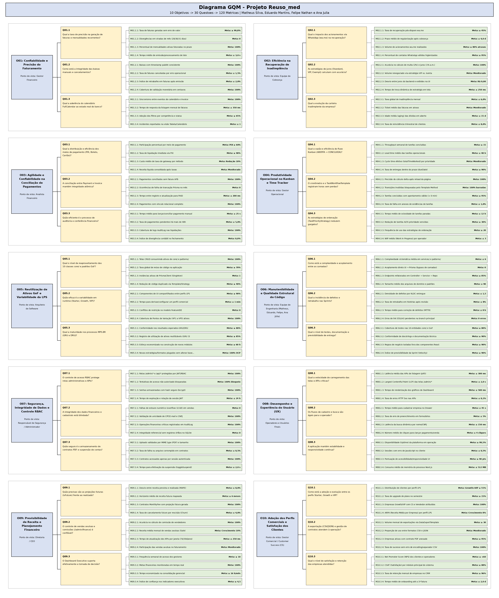
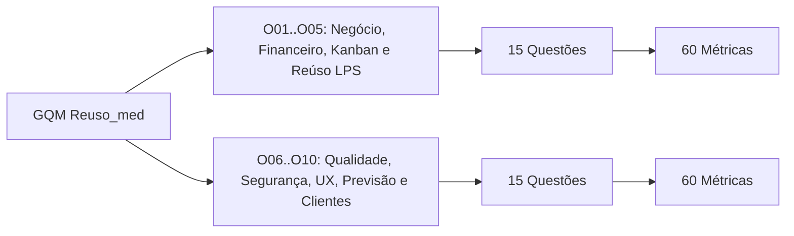

# Documento GQM (Goal Question Metric) — Sistema Reuso_med

> **Disciplina:** Medição e Análise de Processos e Produtos de Software — PUCPR  
> **Projeto:** Reuso_med (`dashboard-main` — Dashboard de Gestão Financeira, Cobranças, Inadimplência, Tarefas e LPS)  
> **Equipe:** Matheus Silva, Eduardo Martins, Felipe Nathan e Ana Júlia  
> **Estrutura:** 10 Objetivos Estratégicos · 30 Questões (3 por Objetivo) · 120 Métricas (4 por Questão)  
> **Representação Gráfica:** [`05_GQM_Diagrama_Reuso_med.png`](./05_GQM_Diagrama_Reuso_med.png) | [`05_GQM_Diagrama_Reuso_med.svg`](./05_GQM_Diagrama_Reuso_med.svg)  
> **Planilha Completa:** [`05_GQM_Reuso_med.xlsx`](./05_GQM_Reuso_med.xlsx)

---

## 1. Visão Geral e Diagrama Hierárquico

---

## 2. Detalhamento Completo dos 10 Objetivos, 30 Questões e 120 Métricas

### O01 — Confiabilidade e Precisão do Faturamento

- **Analisar:** Módulo de Faturamento e Mensalidades (/admin/invoice, MonthlyFee)
- **Com o propósito de:** Avaliar e assegurar a confiabilidade e precisão financeira
- **A respeito de:** Acurácia de emissão, integridade de baixas e sincronismo
- **Do ponto de vista de:** Gestor Financeiro
- **No contexto de:** Sistema Reuso_med (dashboard-main)

#### Q01.1: Qual a taxa de precisão na geração de faturas e mensalidades recorrentes?

| ID | Métrica | Fórmula / Coleta | Unidade | Meta | Frequência | Fonte no Reuso_med |
| :--- | :--- | :--- | :---: | :---: | :---: | :--- |
| **M01.1.1** | Taxa de faturas geradas sem erro de valor | `(Faturas sem divergência / Total emitidas) × 100` | % | **≥ 99,8%** | Mensal | Tabela Invoice |
| **M01.1.2** | Divergências em viradas de mês (28/30/31 dias) | `Contagem de vencimentos gerados fora da regra do dia útil/mês` | unid. | **0** | Mensal | MonthlyFee.generateNextDueDate() |
| **M01.1.3** | Percentual de mensalidades ativas faturadas no prazo | `(MonthlyFee faturadas até dia D / Total ativas) × 100` | % | **100%** | Mensal | Tabelas MonthlyFee e Invoice |
| **M01.1.4** | Tempo médio de emissão/processamento de lote | `Soma dos tempos de geração ÷ Total de lotes executados` | seg | **≤ 3,0 s** | Semanal | Logs API /invoice |

#### Q01.2: Como está a integridade das baixas manuais e cancelamentos?

| ID | Métrica | Fórmula / Coleta | Unidade | Meta | Frequência | Fonte no Reuso_med |
| :--- | :--- | :--- | :---: | :---: | :---: | :--- |
| **M01.2.1** | Baixas com timestamp paidAt consistente | `(Faturas PAID com paidAt válido / Total PAID) × 100` | % | **100%** | Semanal | API markPaid.js |
| **M01.2.2** | Taxa de faturas canceladas por erro operacional | `(Faturas CANCELED por erro / Total emitidas) × 100` | % | **≤ 1,5%** | Mensal | Tabela Invoice + AuditLog |
| **M01.2.3** | Índice de retrabalho em faturas após emissão | `(Faturas editadas pós-emissão / Total emitidas) × 100` | % | **≤ 2,0%** | Mensal | AuditLog |
| **M01.2.4** | Cobertura de validação monetária em centavos | `(Endpoints validando amountCents inteiro / Total endpoints) × 100` | % | **100%** | Por Release | core/entities/Invoice.js |

#### Q01.3: Qual a aderência do calendário FullCalendar ao estado real do banco?

| ID | Métrica | Fórmula / Coleta | Unidade | Meta | Frequência | Fonte no Reuso_med |
| :--- | :--- | :--- | :---: | :---: | :---: | :--- |
| **M01.3.1** | Sincronismo entre eventos do calendário e Invoice | `(Eventos exibidos corretamente / Total faturas do mês) × 100` | % | **100%** | Semanal | /admin/invoice + getInvoices.js |
| **M01.3.2** | Tempo de resposta da listagem mensal de faturas | `Percentil 95 (p95) de latência do endpoint getInvoices` | ms | **≤ 350 ms** | Diária | API getInvoices.js |
| **M01.3.3** | Adoção dos filtros por competência e status | `(Sessões com filtro aplicado / Total sessões na tela) × 100` | % | **≥ 65%** | Mensal | Telemetria UI /admin/invoice |
| **M01.3.4** | Incidentes reportados na visão Tabela/Calendário | `Total de bugs de renderização abertos no mês` | unid. | **≤ 1** | Mensal | GitHub Issues |

### O02 — Eficiência na Recuperação de Inadimplência

- **Analisar:** Módulo de Inadimplentes, Strategy de Juros e Cobrança WhatsApp
- **Com o propósito de:** Maximizar a recuperação de crédito em atraso
- **A respeito de:** Eficácia dos disparos wa.me e precisão das estratégias de juros
- **Do ponto de vista de:** Equipe de Cobrança
- **No contexto de:** Tela /admin/inadimplentes e interestStrategies.js

#### Q02.1: Qual o impacto dos acionamentos via WhatsApp (wa.me) na recuperação?

| ID | Métrica | Fórmula / Coleta | Unidade | Meta | Frequência | Fonte no Reuso_med |
| :--- | :--- | :--- | :---: | :---: | :---: | :--- |
| **M02.1.1** | Taxa de recuperação pós-disparo wa.me | `(Faturas OVERDUE pagas em 7d pós-contato / Total acionadas) × 100` | % | **≥ 45%** | Mensal | /admin/inadimplentes + Invoice |
| **M02.1.2** | Prazo médio de regularização após cobrança | `Média de (paidAt - data do acionamento wa.me)` | dias | **≤ 4,0 d** | Mensal | AuditLog + Invoice |
| **M02.1.3** | Volume de acionamentos wa.me realizados | `Contagem de cliques válidos no botão de cobrança WhatsApp` | unid./mês | **≥ 80% atrasos** | Mensal | UI /admin/inadimplentes |
| **M02.1.4** | Percentual de contatos WhatsApp válidos higienizados | `(Empresas com getCleanWhatsApp() válido / Total) × 100` | % | **≥ 95%** | Mensal | core/entities/Company.js |

#### Q02.2: As estratégias de juros (Standard, VIP, Exempt) calculam com acurácia?

| ID | Métrica | Fórmula / Coleta | Unidade | Meta | Frequência | Fonte no Reuso_med |
| :--- | :--- | :--- | :---: | :---: | :---: | :--- |
| **M02.2.1** | Acurácia no cálculo de multa (2%) e juros (1% a.m.) | `(Cálculos conferidos sem desvio / Total testados) × 100` | % | **100%** | Por Release | StandardInterestStrategy |
| **M02.2.2** | Volume renegociado via estratégia VIP vs. Isenta | `Soma de amountCents liquidados sob VIP ou Exempt` | R$ | **Monitorado** | Mensal | getOverdueClients.js |
| **M02.2.3** | Desvio entre juros do backend e exibidos na UI | `|Valor calculado API - Valor exibido tabela|` | R$ | **R$ 0,00** | Por Release | Testes E2E /inadimplentes |
| **M02.2.4** | Tempo de troca dinâmica de estratégia em tela | `Latência entre seleção do botão Strategy e atualização da UI` | ms | **≤ 250 ms** | Semanal | API ?strategy=STANDARD|VIP |

#### Q02.3: Qual a evolução da carteira inadimplente da empresa?

| ID | Métrica | Fórmula / Coleta | Unidade | Meta | Frequência | Fonte no Reuso_med |
| :--- | :--- | :--- | :---: | :---: | :---: | :--- |
| **M02.3.1** | Taxa global de inadimplência mensal | `(Valor faturas OVERDUE / Valor total faturado no mês) × 100` | % | **≤ 6,0%** | Mensal | Invoice + Dashboard |
| **M02.3.2** | Ticket médio das faturas em atraso | `Soma valor OVERDUE ÷ Quantidade faturas OVERDUE` | R$ | **Monitorado** | Mensal | Tabela Invoice |
| **M02.3.3** | Idade média (aging) das dívidas em aberto | `Média de (Data atual - dueDate) das faturas OVERDUE` | dias | **≤ 15 d** | Semanal | Tabela Invoice |
| **M02.3.4** | Taxa de reincidência trimestral de clientes | `(Empresas com ≥ 2 atrasos no trimestre / Total ativas) × 100` | % | **≤ 8,0%** | Trimestral | Company + Invoice |

### O03 — Agilidade e Confiabilidade na Conciliação de Pagamentos

- **Analisar:** Módulo de Pagamentos (/admin/pagamentos e PaymentStrategy)
- **Com o propósito de:** Assegurar agilidade e atomicidade nas liquidações
- **A respeito de:** Consistência transacional, custos de gateway e auditoria
- **Do ponto de vista de:** Analista Financeiro
- **No contexto de:** paymentService.js, paymentRepository.js e tabela Payment

#### Q03.1: Qual a distribuição e eficiência dos meios de pagamento (PIX, Boleto, Cartão)?

| ID | Métrica | Fórmula / Coleta | Unidade | Meta | Frequência | Fonte no Reuso_med |
| :--- | :--- | :--- | :---: | :---: | :---: | :--- |
| **M03.1.1** | Participação percentual por meio de pagamento | `(Pagamentos método X / Total pagamentos) × 100` | % | **PIX ≥ 60%** | Mensal | Tabela Payment |
| **M03.1.2** | Taxa de liquidação imediata via PIX | `(Pagamentos PIX aprovados na hora / Total PIX) × 100` | % | **≥ 98%** | Semanal | PixPaymentStrategy |
| **M03.1.3** | Custo médio de taxa de gateway por método | `Soma calculateGatewayFeeCents() ÷ Qtd. transações` | R$ | **Redução 10%** | Mensal | core/entities/Payment.js |
| **M03.1.4** | Receita líquida consolidada após taxas | `Soma getNetRevenueCents() por competência` | R$ | **Monitorado** | Mensal | Payment + Dashboard |

#### Q03.2: A conciliação entre Payment e Invoice mantém integridade atômica?

| ID | Métrica | Fórmula / Coleta | Unidade | Meta | Frequência | Fonte no Reuso_med |
| :--- | :--- | :--- | :---: | :---: | :---: | :--- |
| **M03.2.1** | Pagamentos conciliados sem fatura órfã | `(Pagamentos com fatura atualizada para PAID / Total) × 100` | % | **100%** | Diária | paymentRepository.js |
| **M03.2.2** | Ocorrências de falha de transação Prisma no mês | `Contagem de rollbacks ou erros em create-manual.js` | unid. | **0** | Mensal | Logs API /orders |
| **M03.2.3** | Tempo entre registro e atualização para PAID | `Latência média da transação atômica Prisma` | ms | **≤ 200 ms** | Semanal | paymentService.js |
| **M03.2.4** | Pagamentos com vínculo relacional completo | `(Registros Payment com companyId válido / Total) × 100` | % | **100%** | Semanal | Tabela Payment |

#### Q03.3: Quão eficiente é o processo de auditoria e conferência financeira?

| ID | Métrica | Fórmula / Coleta | Unidade | Meta | Frequência | Fonte no Reuso_med |
| :--- | :--- | :--- | :---: | :---: | :---: | :--- |
| **M03.3.1** | Tempo médio para lançar/conciliar pagamento manual | `Cronometragem da abertura do modal até confirmação` | seg | **≤ 25 s** | Mensal | UX /admin/pagamentos |
| **M03.3.2** | Taxa de pagamentos pendentes há mais de 48h | `(Pagamentos PENDING > 48h / Total pendentes) × 100` | % | **≤ 5,0%** | Semanal | Tabela Payment |
| **M03.3.3** | Cobertura de logs AuditLog nas liquidações | `(Liquidações com registro em AuditLog / Total) × 100` | % | **100%** | Semanal | AuditLog |
| **M03.3.4** | Índice de divergência contábil no fechamento | `|Total Payment PAID - Total Invoice PAID| ÷ Total` | % | **0,0%** | Mensal | Conciliação Mensal |

### O04 — Produtividade Operacional no Kanban e Time Tracker

- **Analisar:** Quadro Kanban de Tarefas e Cronômetro (/admin/tarefas)
- **Com o propósito de:** Otimizar a produtividade da equipe e precisão do apontamento
- **A respeito de:** Vazão, lead time, persistência do cronômetro e priorização
- **Do ponto de vista de:** Gestor Operacional
- **No contexto de:** TaskWorkflowTemplate.js, TaskPriorityStrategy e tabela Task

#### Q04.1: Qual a vazão e eficiência do fluxo Kanban (ABERTA → CONCLUIDA)?

| ID | Métrica | Fórmula / Coleta | Unidade | Meta | Frequência | Fonte no Reuso_med |
| :--- | :--- | :--- | :---: | :---: | :---: | :--- |
| **M04.1.1** | Throughput semanal de tarefas concluídas | `Total de tarefas movidas para CONCLUIDA na semana` | tarefas/sem | **≥ 15** | Semanal | Tabela Task |
| **M04.1.2** | Lead time médio das tarefas operacionais | `Média de (finishedAt - createdAt) em horas` | horas | **≤ 48 h** | Semanal | Tabela Task |
| **M04.1.3** | Cycle time efetivo (totalTimeWorked) por prioridade | `Média de totalTimeWorked agrupada por ALTA/MEDIA/BAIXA` | horas | **Monitorado** | Quinzenal | Task.getFormattedTimeWorked() |
| **M04.1.4** | Taxa de entregas dentro do prazo (dueDate) | `(Tarefas concluídas com finishedAt ≤ dueDate / Total) × 100` | % | **≥ 90%** | Mensal | Tabela Task |

#### Q04.2: O cronômetro e o TaskWorkflowTemplate registram horas sem perdas?

| ID | Métrica | Fórmula / Coleta | Unidade | Meta | Frequência | Fonte no Reuso_med |
| :--- | :--- | :--- | :---: | :---: | :---: | :--- |
| **M04.2.1** | Precisão do cálculo delta após reload da página | `(Sessões sem perda de segundos / Total pausas) × 100` | % | **100%** | Por Release | PauseTaskWorkflow |
| **M04.2.2** | Transições inválidas bloqueadas pelo Template Method | `Contagem de tentativas barradas em validateTransition()` | unid. | **100% barradas** | Mensal | TaskWorkflowTemplate.js |
| **M04.2.3** | Tarefas concluídas com apontamento válido (> 0 min) | `(Tarefas CONCLUIDA com totalTimeWorked > 0 / Total) × 100` | % | **≥ 95%** | Semanal | Tabela Task |
| **M04.2.4** | Taxa de falha em anexos de evidências de tarefas | `(Uploads de anexo com erro / Total tentativas) × 100` | % | **≤ 1,0%** | Mensal | Task.attachmentUrl |

#### Q04.3: As estratégias de ordenação (TaskPriorityStrategy) reduzem gargalos?

| ID | Métrica | Fórmula / Coleta | Unidade | Meta | Frequência | Fonte no Reuso_med |
| :--- | :--- | :--- | :---: | :---: | :---: | :--- |
| **M04.3.1** | Tempo médio de ociosidade de tarefas paradas | `Média de tempo sem atualização (IdleTimePriority)` | horas | **≤ 12 h** | Semanal | IdleTimePriorityStrategy |
| **M04.3.2** | Redução de tarefas ALTA prioridade vencidas | `((Atrasos antes - Atrasos pós-Strategy) / Antes) × 100` | % | **≥ 30%** | Mensal | SeverityPriorityStrategy |
| **M04.3.3** | Frequência de uso das estratégias de ordenação | `Contagem de trocas entre Prazo / Ociosidade / Gravidade` | acessos/sem | **≥ 20** | Semanal | UI /admin/tarefas |
| **M04.3.4** | WIP médio (Work In Progress) por operador | `Média diária de tarefas EM_ANDAMENTO por assigneeId` | unid. | **≤ 3** | Diária | Tabela Task |

### O05 — Reutilização de Ativos GoF e Variabilidade da LPS

- **Analisar:** Arquitetura Core Assets, Padrões GoF e Configurador LPS
- **Com o propósito de:** Maximizar o reúso sistemático e derivação de produtos
- **A respeito de:** Taxa de reúso, variabilidade em runtime e maturidade MPS.BR
- **Do ponto de vista de:** Arquiteto de Software
- **No contexto de:** core/, patterns/, model.xml e /admin/variabilidade

#### Q05.1: Qual o nível de reaproveitamento das 10 classes core/ e padrões GoF?

| ID | Métrica | Fórmula / Coleta | Unidade | Meta | Frequência | Fonte no Reuso_med |
| :--- | :--- | :--- | :---: | :---: | :---: | :--- |
| **M05.1.1** | Telas CRUD consumindo ativos de core/ e patterns/ | `(Telas usando core/patterns / Total 8 telas CRUD) × 100` | % | **100%** | Por Release | Estrutura do Repositório |
| **M05.1.2** | Taxa global de reúso de código na aplicação | `(SLOC reutilizado ou compartilhado / SLOC total) × 100` | % | **≥ 70%** | Por Release | Contagem SLOC |
| **M05.1.3** | Instâncias ativas de PrismaClient (Singleton) | `Número de conexões Prisma abertas simultaneamente` | unid. | **1** | Contínua | DatabaseConnection.js |
| **M05.1.4** | Redução de código duplicado via Template/Strategy | `(SLOC eliminado após refatoração GoF / SLOC anterior) × 100` | % | **≥ 40%** | Por Release | Histórico Git |

#### Q05.2: Quão eficaz é a variabilidade em runtime (Starter, Growth, VIP)?

| ID | Métrica | Fórmula / Coleta | Unidade | Meta | Frequência | Fonte no Reuso_med |
| :--- | :--- | :--- | :---: | :---: | :---: | :--- |
| **M05.2.1** | Componentes de UI compartilhados entre perfis LPS | `(Componentes comuns / Total componentes nos 3 perfis) × 100` | % | **≥ 90%** | Por Release | CompaniesTable.jsx |
| **M05.2.2** | Tempo para derivar/configurar um perfil comercial | `Tempo de alternância e validação na UI /variabilidade` | min | **≤ 1 min** | Por Teste | /admin/variabilidade |
| **M05.2.3** | Conflitos de restrição no modelo FeatureIDE | `Erros detectados na validação booleana de model.xml` | unid. | **0** | Por Release | model.xml (FeatureIDE) |
| **M05.2.4** | Cobertura de Pontos de Variação (VP1 a VP5) ativos | `(VPs implementados em código / 5 VPs planejados) × 100` | % | **100%** | Por Release | DOCUMENTACAO_ENGENHARIA_REUSO.md |

#### Q05.3: Qual a maturidade nos processos MPS.BR (GRU e DRU)?

| ID | Métrica | Fórmula / Coleta | Unidade | Meta | Frequência | Fonte no Reuso_med |
| :--- | :--- | :--- | :---: | :---: | :---: | :--- |
| **M05.3.1** | Conformidade nos resultados esperados GRU/DRU | `(Itens Verde + Amarelo / Total itens GRU 1-5 e DRU 1-5) × 100` | % | **≥ 80%** | Semestral | RELATORIO_MPSBR_GRU_DRU.md |
| **M05.3.2** | Registro de utilização de ativos reutilizáveis (GRU 3) | `(Chamadas GoF/Core logadas / Total execuções) × 100` | % | **≥ 85%** | Mensal | AuditLog / Telemetria |
| **M05.3.3** | Esforço economizado na construção de novos módulos | `Horas estimadas sem reúso - Horas reais com Core Assets` | horas | **≥ 60 h** | Por Sprint | Backlog + COCOMO II |
| **M05.3.4** | Novas estratégias/formatos plugados sem alterar base (OCP) | `Contagem de extensões (ex: XML, MercadoPago) sem editar base` | unid. | **100% OCP** | Por Release | patterns/ |

### O06 — Manutenibilidade e Qualidade Estrutural do Código

- **Analisar:** Base de Código em Camadas do Reuso_med
- **Com o propósito de:** Garantir facilidade de manutenção e baixa densidade de defeitos
- **A respeito de:** Complexidade, acoplamento, defeitos e cobertura de testes
- **Do ponto de vista de:** Equipe de Engenharia (Matheus, Eduardo, Felipe, Ana Júlia)
- **No contexto de:** Repositório dashboard-main e ciclos de Sprint

#### Q06.1: Como está a complexidade e acoplamento entre as camadas?

| ID | Métrica | Fórmula / Coleta | Unidade | Meta | Frequência | Fonte no Reuso_med |
| :--- | :--- | :--- | :---: | :---: | :---: | :--- |
| **M06.1.1** | Complexidade ciclomática média em services/ e patterns/ | `Média de caminhos independentes por método (ESLint/análise)` | valor | **≤ 6** | Por PR | services/ e patterns/ |
| **M06.1.2** | Acoplamento direto UI → Prisma (bypass de camadas) | `Contagem de imports diretos de PrismaClient em pages/admin/*` | unid. | **0** | Por PR | Análise estática |
| **M06.1.3** | Endpoints refatorados em Controller → Service → Repo | `(Rotas usando camada de serviço / Total rotas domínio) × 100` | % | **≥ 85%** | Por Release | pages/api/ |
| **M06.1.4** | Tamanho médio dos arquivos de domínio e padrões | `SLOC total em core/ + patterns/ ÷ Número de arquivos` | linhas | **≤ 90** | Por Release | core/ e patterns/ |

#### Q06.2: Qual a incidência de defeitos e retrabalho nas Sprints?

| ID | Métrica | Fórmula / Coleta | Unidade | Meta | Frequência | Fonte no Reuso_med |
| :--- | :--- | :--- | :---: | :---: | :---: | :--- |
| **M06.2.1** | Densidade de defeitos por KLOC entregue | `Total de bugs encontrados ÷ 16,024 KLOC` | bugs/KLOC | **≤ 1,5** | Por Sprint | GitHub Issues + SLOC |
| **M06.2.2** | Taxa de retrabalho em histórias após revisão | `(Story Points reabertos / Total Story Points entregues) × 100` | % | **≤ 8%** | Por Sprint | Quadro Sprint |
| **M06.2.3** | Tempo médio para correção de defeitos (MTTR) | `Soma (Data fechamento bug - Data abertura) ÷ Qtd. bugs` | horas | **≤ 8 h** | Mensal | GitHub Issues |
| **M06.2.4** | Erros de lint (ESLint) pendentes na branch principal | `Contagem retornada pelo comando npm run lint` | unid. | **0 erros** | Contínua | ESLint |

#### Q06.3: Qual o nível de testes, documentação e previsibilidade de entrega?

| ID | Métrica | Fórmula / Coleta | Unidade | Meta | Frequência | Fonte no Reuso_med |
| :--- | :--- | :--- | :---: | :---: | :---: | :--- |
| **M06.3.1** | Cobertura de testes nas 10 entidades core/ e GoF | `(Métodos de negócio testados / Total métodos core+patterns) × 100` | % | **≥ 80%** | Por Release | Suíte de Testes |
| **M06.3.2** | Conformidade de docstrings e documentação técnica | `(Classes e funções públicas documentadas / Total) × 100` | % | **≥ 90%** | Por PR | core/ + patterns/ |
| **M06.3.3** | Regras de negócio isoladas fora dos componentes React | `(Regras em core/patterns/services / Total regras) × 100` | % | **≥ 90%** | Por Release | Revisão Arquitetural |
| **M06.3.4** | Índice de previsibilidade da Sprint (Velocity) | `(Story Points concluídos / Story Points planejados) × 100` | % | **≥ 90%** | Por Sprint | Backlog_Sprints |

### O07 — Segurança, Integridade de Dados e Controle RBAC

- **Analisar:** Autenticação NextAuth, RBAC, Prisma SQLite e Firebase Storage
- **Com o propósito de:** Proteger dados sensíveis e garantir integridade transacional
- **A respeito de:** Autenticação, blindagem numérica, auditoria e proteção de arquivos
- **Do ponto de vista de:** Responsável de Segurança / Administrador
- **No contexto de:** pages/api/auth, User, AuditLog e Storage

#### Q07.1: O controle de acesso RBAC protege rotas administrativas e APIs?

| ID | Métrica | Fórmula / Coleta | Unidade | Meta | Frequência | Fonte no Reuso_med |
| :--- | :--- | :--- | :---: | :---: | :---: | :--- |
| **M07.1.1** | Rotas /admin/* e /api/* protegidas por JWT/RBAC | `(Rotas com checagem de sessão+role / Total rotas privadas) × 100` | % | **100%** | Por Release | [...nextauth].js + Middleware |
| **M07.1.2** | Tentativas de acesso não autorizado bloqueadas | `Total de respostas HTTP 401/403 registradas corretamente` | unid. | **100% bloqueio** | Semanal | Logs de API |
| **M07.1.3** | Senhas armazenadas com hash seguro (bcrypt) | `(Usuários com hash bcrypt válido / Total tabela User) × 100` | % | **100%** | Mensal | createUser.js / checkCredentials.js |
| **M07.1.4** | Tempo de expiração e rotação da sessão JWT | `TTL configurado para tokens de sessão ativa` | horas | **≤ 24 h** | Por Release | NextAuth Config |

#### Q07.2: A integridade dos dados financeiros e cadastrais está blindada?

| ID | Métrica | Fórmula / Coleta | Unidade | Meta | Frequência | Fonte no Reuso_med |
| :--- | :--- | :--- | :---: | :---: | :---: | :--- |
| **M07.2.1** | Falhas de estouro numérico (overflow 32-bit) em vendas | `Ocorrências de erro de teto em amountCents no banco` | unid. | **0** | Contínua | create-manual.js + Payment |
| **M07.2.2** | Validação de unicidade de CPF/E-mail e CNPJ | `(Cadastros rejeitados na duplicidade / Tentativas duplicadas) × 100` | % | **100%** | Semanal | schema.prisma + Company.js |
| **M07.2.3** | Operações financeiras críticas registradas em AuditLog | `(Mutações em Invoice/Payment/Sale auditadas / Total) × 100` | % | **100%** | Semanal | core/entities/AuditLog.js |
| **M07.2.4** | Integridade referencial sem registros órfãos no SQLite | `Contagem de FKs inválidas em Invoice, Payment e Task` | unid. | **0** | Mensal | prisma/dev.db |

#### Q07.3: Quão seguro é o armazenamento de contratos PDF e suspensão de contas?

| ID | Métrica | Fórmula / Coleta | Unidade | Meta | Frequência | Fonte no Reuso_med |
| :--- | :--- | :--- | :---: | :---: | :---: | :--- |
| **M07.3.1** | Uploads validados por MIME type (PDF) e tamanho | `(Uploads validados antes do Firebase / Total uploads) × 100` | % | **100%** | Semanal | pages/api/server/storage/upload.js |
| **M07.3.2** | Taxa de falha ou arquivo corrompido em contratos | `(Uploads corrompidos / Total uploads realizados) × 100` | % | **≤ 0,5%** | Mensal | Firebase Storage |
| **M07.3.3** | Contratos acessados apenas por sessão autenticada | `(Downloads com token válido / Total downloads) × 100` | % | **100%** | Mensal | API Storage + RBAC |
| **M07.3.4** | Tempo para efetivação da suspensão (toggleSuspend) | `Latência entre clique de suspensão e bloqueio do usuário` | seg | **≤ 2,0 s** | Por Teste | toggleSuspend.js |

### O08 — Desempenho e Experiência do Usuário (UX)

- **Analisar:** Interface Next.js/React e APIs do Reuso_med
- **Com o propósito de:** Oferecer alta responsividade e fluidez operacional
- **A respeito de:** Latência de API, renderização de gráficos, usabilidade e estabilidade
- **Do ponto de vista de:** Operadores e Usuários Finais
- **No contexto de:** Todas as telas /admin/* no navegador

#### Q08.1: Qual a velocidade de carregamento das telas e APIs críticas?

| ID | Métrica | Fórmula / Coleta | Unidade | Meta | Frequência | Fonte no Reuso_med |
| :--- | :--- | :--- | :---: | :---: | :---: | :--- |
| **M08.1.1** | Latência média das APIs de listagem (p95) | `Tempo de resposta de getAllCompanies, getInvoices e getTasks` | ms | **≤ 300 ms** | Diária | Next.js API Routes |
| **M08.1.2** | Largest Contentful Paint (LCP) das telas /admin/* | `Média de LCP medida via Lighthouse / Web Vitals` | seg | **≤ 2,0 s** | Por Release | Lighthouse |
| **M08.1.3** | Tempo de renderização dos gráficos do Dashboard | `Tempo da resposta da API até desenho completo Chart.js/Apex` | ms | **≤ 500 ms** | Semanal | /admin/dashboard |
| **M08.1.4** | Taxa de erros HTTP 5xx nas APIs | `(Respostas 5xx / Total requisições API) × 100` | % | **≤ 0,1%** | Diária | Logs do Servidor |

#### Q08.2: Os fluxos de cadastro e busca são ágeis para o operador?

| ID | Métrica | Fórmula / Coleta | Unidade | Meta | Frequência | Fonte no Reuso_med |
| :--- | :--- | :--- | :---: | :---: | :---: | :--- |
| **M08.2.1** | Tempo médio para cadastrar empresa no Drawer | `Tempo médio do clique "Nova Empresa" até salvamento` | seg | **≤ 45 s** | Mensal | CompanyDrawer.jsx |
| **M08.2.2** | Taxa de erro de preenchimento em formulários | `(Submissões rejeitadas por máscara/CNPJ / Total) × 100` | % | **≤ 5%** | Mensal | Formulários CRM/Finance |
| **M08.2.3** | Latência da busca dinâmica por nome/CNPJ | `Tempo entre digitação e atualização filtrada da tabela` | ms | **≤ 150 ms** | Semanal | useCompaniesPage.js |
| **M08.2.4** | Número médio de cliques para lançar pagamento/venda | `Contagem de passos UI da tela até persistência confirmada` | cliques | **≤ 4 cliques** | Por Release | /admin/pagamentos e /finance |

#### Q08.3: A aplicação mantém estabilidade e responsividade contínua?

| ID | Métrica | Fórmula / Coleta | Unidade | Meta | Frequência | Fonte no Reuso_med |
| :--- | :--- | :--- | :---: | :---: | :---: | :--- |
| **M08.3.1** | Disponibilidade (Uptime) da plataforma em operação | `(Tempo disponível / Tempo total monitorado) × 100` | % | **≥ 99,5%** | Mensal | Monitoramento Produção |
| **M08.3.2** | Sessões com erro de JavaScript no cliente | `(Sessões com unhandled error / Total sessões) × 100` | % | **≤ 0,5%** | Semanal | Browser Telemetry |
| **M08.3.3** | Pontuação de acessibilidade/responsividade UI | `Score Lighthouse Accessibility & Best Practices` | pts (0-100) | **≥ 90 pts** | Por Release | Lighthouse |
| **M08.3.4** | Consumo médio de memória do processo Next.js | `RSS médio de memória em carga operacional normal` | MB | **≤ 512 MB** | Semanal | Monitoramento Node.js |

### O09 — Previsibilidade de Receita e Planejamento Financeiro

- **Analisar:** Módulos de Recebíveis Futuros, Vendas e Dashboard Executivo
- **Com o propósito de:** Aumentar a assertividade das projeções de fluxo de caixa
- **A respeito de:** Precisão previsto vs. realizado, vendas avulsas e suporte à decisão
- **Do ponto de vista de:** Diretoria / CEO
- **No contexto de:** /admin/futures, /admin/finance e /admin/dashboard

#### Q09.1: Quão precisas são as projeções futuras (isFuture) frente ao realizado?

| ID | Métrica | Fórmula / Coleta | Unidade | Meta | Frequência | Fonte no Reuso_med |
| :--- | :--- | :--- | :---: | :---: | :---: | :--- |
| **M09.1.1** | Desvio entre receita prevista e realizada (MAPE) | `|Receita Prevista - Realizada| ÷ Realizada × 100` | % | **≤ 8,0%** | Mensal | /admin/futures + Dashboard |
| **M09.1.2** | Horizonte médio de receita futura mapeada | `Número de meses futuros com faturas programadas ativas` | meses | **≥ 6 meses** | Mensal | Invoice (isFuture=true) |
| **M09.1.3** | Contratos MonthlyFee com projeção futura gerada | `(MonthlyFee ativos com futuras / Total ativos) × 100` | % | **100%** | Mensal | getFutureInvoices.js |
| **M09.1.4** | Taxa de cancelamento futuro por rescisão (Churn) | `(Valor futuro cancelado / Valor futuro total do mês) × 100` | % | **≤ 4,0%** | Mensal | cancelFutureMonthlyFees.js |

#### Q09.2: O controle de vendas avulsas e comissões (/admin/finance) é confiável?

| ID | Métrica | Fórmula / Coleta | Unidade | Meta | Frequência | Fonte no Reuso_med |
| :--- | :--- | :--- | :---: | :---: | :---: | :--- |
| **M09.2.1** | Acurácia no cálculo de comissão de vendedores | `(Comissões validadas corretamente / Total vendas) × 100` | % | **100%** | Mensal | Sale.calculateCommissionCents() |
| **M09.2.2** | Receita média mensal de vendas avulsas (Sale) | `Soma amountCents da tabela Sale no mês` | R$ | **Crescimento 10%** | Mensal | Tabela Sale |
| **M09.2.3** | Tempo de atualização dos KPIs por janela (7d/30d/ano) | `Latência de getTotalApprovedPayments e filtros de período` | ms | **≤ 250 ms** | Semanal | /admin/finance |
| **M09.2.4** | Participação das vendas avulsas no faturamento | `(Receita Sale / (Receita Sale + MonthlyFee)) × 100` | % | **Monitorado** | Mensal | Dashboard Executivo |

#### Q09.3: O Dashboard Executivo suporta efetivamente a tomada de decisão?

| ID | Métrica | Fórmula / Coleta | Unidade | Meta | Frequência | Fonte no Reuso_med |
| :--- | :--- | :--- | :---: | :---: | :---: | :--- |
| **M09.3.1** | Frequência semanal de acesso dos gestores | `Quantidade de acessos únicos ao /admin/dashboard por semana` | acessos/sem | **≥ 10** | Semanal | Logs /admin/dashboard |
| **M09.3.2** | Metas financeiras monitoradas em tempo real | `(KPIs estratégicos visíveis / Total KPIs definidos) × 100` | % | **100%** | Por Release | /admin/dashboard |
| **M09.3.3** | Tempo economizado na consolidação gerencial | `Horas gastas em planilhas manuais antes - Horas pós-sistema` | horas/mês | **≥ 16 h/mês** | Mensal | Pesquisa Gestão |
| **M09.3.4** | Índice de confiança nos indicadores executivos | `Nota média atribuída pela diretoria aos números do painel` | nota (1-5) | **≥ 4,5** | Trimestral | Feedback Diretoria |

### O10 — Adoção dos Perfis Comerciais e Satisfação dos Clientes

- **Analisar:** CRM, Planos LPS (Starter/Growth/VIP) e Exportação de Dados
- **Com o propósito de:** Ampliar adoção comercial, retenção e satisfação dos clientes
- **A respeito de:** Uso dos planos LPS, uso de exportação e indicadores de satisfação
- **Do ponto de vista de:** Gestor Comercial / Customer Success (CS)
- **No contexto de:** /admin/companies, /admin/variabilidade e /api/invoice/export

#### Q10.1: Como está a adoção e evolução entre os perfis Starter, Growth e VIP?

| ID | Métrica | Fórmula / Coleta | Unidade | Meta | Frequência | Fonte no Reuso_med |
| :--- | :--- | :--- | :---: | :---: | :---: | :--- |
| **M10.1.1** | Distribuição de clientes por perfil LPS | `(Empresas no perfil X / Total empresas ativas) × 100` | % | **Growth+VIP ≥ 55%** | Mensal | Company + SubscriptionPlan |
| **M10.1.2** | Taxa de upgrade de plano no semestre | `(Empresas que migraram Starter → Growth/VIP / Base) × 100` | % | **≥ 15%** | Semestral | Histórico de Planos |
| **M10.1.3** | Empresas Growth/VIP com CS e Vendedor atribuídos | `(Empresas com csId e sellerId ≠ null / Total Growth+VIP) × 100` | % | **100%** | Semanal | Tabela Company |
| **M10.1.4** | ARPA (Receita Média por Empresa) por perfil LPS | `Receita mensal do segmento ÷ Qtd. empresas do segmento` | R$ | **Crescimento 8%** | Mensal | Company + Invoice |

#### Q10.2: A exportação (CSV/JSON) e gestão de contratos atendem à operação?

| ID | Métrica | Fórmula / Coleta | Unidade | Meta | Frequência | Fonte no Reuso_med |
| :--- | :--- | :--- | :---: | :---: | :---: | :--- |
| **M10.2.1** | Volume mensal de exportações via DataExportTemplate | `Contagem de downloads em /api/invoice/export` | unid./mês | **≥ 30** | Mensal | export.js |
| **M10.2.2** | Proporção de uso entre formatos CSV e JSON | `(% downloads CSV vs. % downloads JSON)` | % | **Monitorado** | Mensal | Query ?format=csv|json |
| **M10.2.3** | Empresas ativas com contrato PDF anexado | `(Empresas com contractUrl válido / Total ativas) × 100` | % | **≥ 95%** | Mensal | Tabela Company |
| **M10.2.4** | Taxa de sucesso sem erro de encoding/separador CSV | `(Exportações abertas corretamente / Total testadas) × 100` | % | **100%** | Por Release | CsvInvoiceExport |

#### Q10.3: Qual o nível de satisfação e retenção das empresas atendidas?

| ID | Métrica | Fórmula / Coleta | Unidade | Meta | Frequência | Fonte no Reuso_med |
| :--- | :--- | :--- | :---: | :---: | :---: | :--- |
| **M10.3.1** | Net Promoter Score (NPS) dos clientes e operadores | `% Promotores (9-10) - % Detratores (0-6)` | score (-100..100) | **≥ +60** | Trimestral | Pesquisa NPS |
| **M10.3.2** | CSAT (Satisfação) por módulo principal do sistema | `(Avaliações positivas 4-5 / Total avaliações) × 100` | % | **≥ 88%** | Trimestral | Pesquisa CSAT |
| **M10.3.3** | Taxa de retenção mensal de empresas no CRM | `((Empresas fim - Novas) / Empresas início mês) × 100` | % | **≥ 96%** | Mensal | Tabela Company |
| **M10.3.4** | Tempo médio de onboarding até a 1ª fatura | `Média de (1ª Invoice.createdAt - Company.createdAt)` | dias | **≤ 2,0 d** | Mensal | Company + Invoice |
