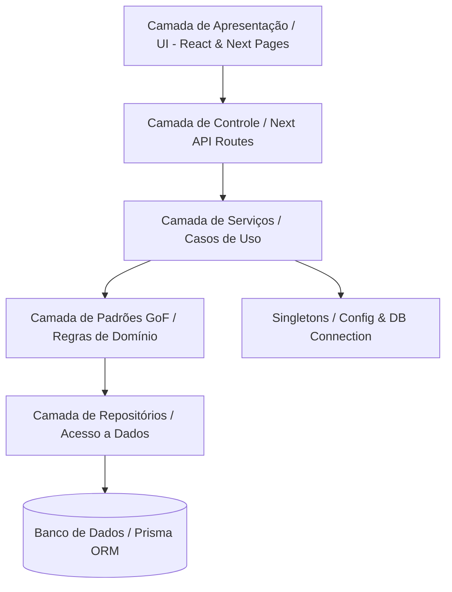
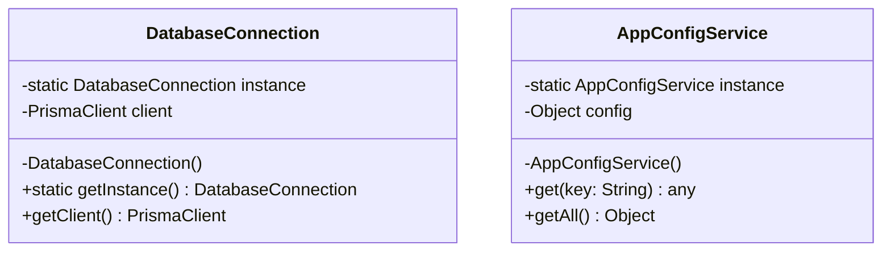
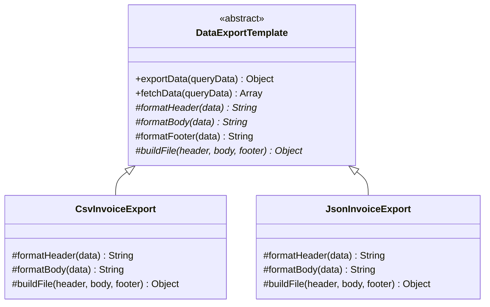
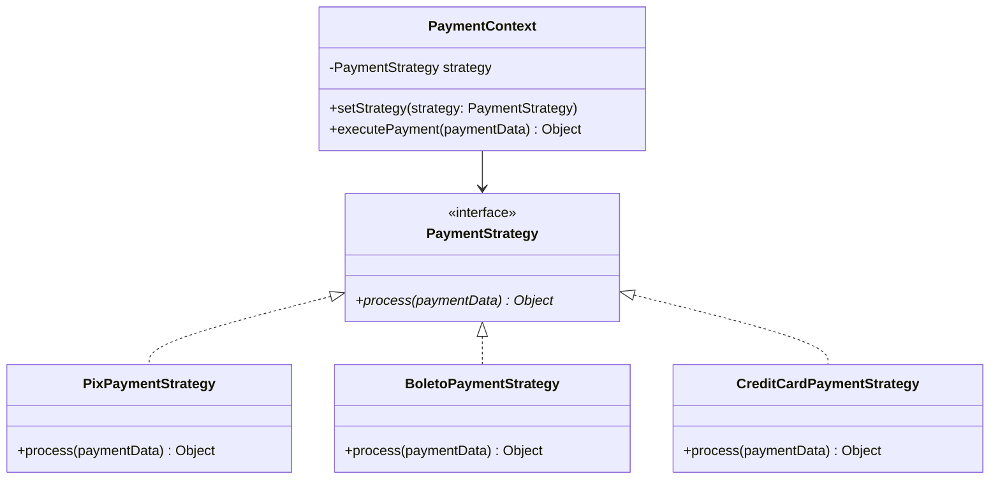

# Documentação de Engenharia de Software e Padrões de Reúso (GoF)

> **Projeto**: Dashboard de Gestão Financeira, Cobranças e Tarefas  
> **Disciplina / Foco**: Engenharia de Software & Reúso de Software  
> **Objetivo**: Transição de código ad-hoc (*vibe coding*) para uma arquitetura modular, manutenível e extensível através de padrões de projeto (GoF) e separação de responsabilidades.

---

## 1. Visão Geral e Arquitetura Proposta

Para elevar a manutenibilidade, testabilidade e potencial de reúso do sistema, a aplicação adota uma **Arquitetura em Camadas (Layered Architecture)** com desacoplamento de infraestrutura, regras de negócio e apresentação.



### Estrutura de Diretórios Recomendada

```text
dashboard-main/
├── core/                      # Regras de negócio puras (Enterprise Business Rules)
│   ├── entities/              # Modelos e validações centrais
│   └── errors/                # Classes de erro de domínio
├── patterns/                  # Catálogo de Design Patterns implementados
│   ├── singleton/             # DatabaseConnection, AppConfigService
│   ├── template-method/       # DataExportTemplate, TaskWorkflowTemplate, InvoiceImporterTemplate
│   └── strategy/              # PaymentStrategy, InterestStrategy, TaskPriorityStrategy
├── services/                  # Casos de uso da aplicação (Application Services)
│   ├── invoiceService.js
│   ├── paymentService.js
│   └── taskService.js
├── repositories/              # Acesso ao banco de dados com Prisma encapsulado
│   ├── invoiceRepository.js
│   └── companyRepository.js
├── pages/api/                 # Controllers HTTP (Next.js API Routes)
└── components/                # Componentes visuais reutilizáveis
```

---

## 2. Catálogo de Padrões de Projeto (GoF)

---

###  Singleton (2 Exemplos)

O padrão **Singleton** garante que uma classe possua apenas uma única instância durante toda a execução da aplicação e fornece um ponto de acesso global a ela.



#### Exemplo 1: `DatabaseConnection` (Instância Única do Prisma Client)
* **Problema**: Evita que múltiplas conexões com o banco de dados sejam abertas a cada requisição ou recarga no Next.js (hot-reloading).
* **Arquivo**: `patterns/singleton/DatabaseConnection.js`

```javascript
import { PrismaClient } from "@prisma/client";

class DatabaseConnection {
  constructor() {
    if (!DatabaseConnection.instance) {
      this.client = new PrismaClient({
        log: process.env.NODE_ENV === "development" ? ["query", "error", "warn"] : ["error"],
      });
      DatabaseConnection.instance = this;
    }
    return DatabaseConnection.instance;
  }

  getClient() {
    return this.client;
  }
}

const instance = Object.freeze(new DatabaseConnection());
export default instance.getClient();
```

#### Exemplo 2: `AppConfigService` (Gerenciador Central de Configurações)
* **Problema**: Centralizar constantes de negócio, flags de funcionalidades e regras de tolerância em memória com acesso imutável.
* **Arquivo**: `patterns/singleton/AppConfigService.js`

```javascript
class AppConfigService {
  constructor() {
    if (AppConfigService.instance) {
      return AppConfigService.instance;
    }

    this.config = {
      defaultCurrency: "BRL",
      invoiceGracePeriodDays: 5,
      defaultFinePercent: 0.02, // 2% multa
      defaultDailyInterestPercent: 0.00033, // ~1% ao mês proporcional
      environment: process.env.NODE_ENV || "development",
    };

    AppConfigService.instance = this;
    Object.freeze(this);
  }

  get(key) {
    return this.config[key];
  }

  getAll() {
    return { ...this.config };
  }
}

export default new AppConfigService();
```

---

###  Template Method (3 Exemplos)

O padrão **Template Method** define o esqueleto invariante de um algoritmo na superclasse, delegando etapas específicas para as subclasses concretas sem alterar a estrutura global.



#### Exemplo 1: `DataExportTemplate` (Exportação de Relatórios Financeiros)
* **Problema**: A rotina de exportação possui sempre o mesmo fluxo (buscar dados -> cabeçalho -> corpo -> rodapé -> empacotar), mas os formatos (CSV, JSON, XML) geram saídas distintas.
* **Arquivo**: `patterns/template-method/DataExportTemplate.js`

```javascript
export class DataExportTemplate {
  // Template Method: Algoritmo invariante
  async exportData(queryData) {
    const rawData = await this.fetchData(queryData);
    const header = this.formatHeader(rawData);
    const body = this.formatBody(rawData);
    const footer = this.formatFooter(rawData);
    return this.buildFile(header, body, footer);
  }

  async fetchData(queryData) {
    return queryData; // Hook padrão
  }

  // Métodos primitivos que as subclasses devem implementar
  formatHeader(data) { throw new Error("Método formatHeader deve ser implementado."); }
  formatBody(data) { throw new Error("Método formatBody deve ser implementado."); }
  formatFooter(data) { return ""; } // Hook opcional
  buildFile(header, body, footer) { throw new Error("Método buildFile deve ser implementado."); }
}

// Subclasse Concreta 1: Exportador CSV
export class CsvInvoiceExport extends DataExportTemplate {
  formatHeader() {
    return "ID,Empresa,Valor(Centavos),Vencimento,Status\n";
  }

  formatBody(invoices) {
    return invoices.map(i => `${i.id},"${i.companyName}",${i.amountCents},${i.dueDate},${i.status}`).join("\n");
  }

  buildFile(header, body) {
    return { mimeType: "text/csv", content: header + body };
  }
}

// Subclasse Concreta 2: Exportador JSON
export class JsonInvoiceExport extends DataExportTemplate {
  formatHeader() { return ""; }
  formatBody(invoices) { return JSON.stringify(invoices, null, 2); }
  buildFile(header, body) {
    return { mimeType: "application/json", content: body };
  }
}
```

#### Exemplo 2: `TaskWorkflowTemplate` (Transição de Estados de Tarefas)
* **Problema**: Transições de status de tarefas exigem uma ordem obrigatória: validar permissão -> registrar timestamps -> salvar no banco -> disparar eventos/notificações.
* **Arquivo**: `patterns/template-method/TaskWorkflowTemplate.js`

```javascript
export class TaskWorkflowTemplate {
  // Template Method
  async executeTransition(task, user) {
    this.validatePermissions(task, user);
    const updatedData = this.calculateTimestamps(task);
    const savedTask = await this.persistTransition(task.id, updatedData);
    await this.afterTransition(savedTask);
    return savedTask;
  }

  validatePermissions(task, user) {
    if (!user) throw new Error("Acesso negado: Usuário não autenticado.");
  }

  calculateTimestamps(task) { throw new Error("calculateTimestamps obrigatório."); }
  async persistTransition(taskId, data) { throw new Error("persistTransition obrigatório."); }
  async afterTransition(task) { /* Hook opcional */ }
}

// Subclasse: Início da Tarefa
export class StartTaskWorkflow extends TaskWorkflowTemplate {
  calculateTimestamps(task) {
    return {
      status: "EM_ANDAMENTO",
      startedAt: task.startedAt || new Date(),
      lastResumeAt: new Date(),
    };
  }

  async persistTransition(taskId, data) {
    return { id: taskId, ...data };
  }
}

// Subclasse: Conclusão da Tarefa
export class CompleteTaskWorkflow extends TaskWorkflowTemplate {
  calculateTimestamps(task) {
    return {
      status: "CONCLUIDA",
      finishedAt: new Date(),
    };
  }

  async persistTransition(taskId, data) {
    return { id: taskId, ...data };
  }

  async afterTransition(task) {
    console.log(`[Auditoria/Notificação] Tarefa #${task.id} finalizada com sucesso.`);
  }
}
```

#### Exemplo 3: `InvoiceImporterTemplate` (Importação e Processamento de Cobranças)
* **Problema**: Processamento de faturas de origens externas (Spedy, planilhas ou ERPs) seguindo as fases de *parse*, *validação de regras fiscais*, *enriquecimento de dados* e *persistência*.
* **Arquivo**: `patterns/template-method/InvoiceImporterTemplate.js`

```javascript
export class InvoiceImporterTemplate {
  // Template Method
  async processImport(rawPayload) {
    const records = this.parseRecords(rawPayload);
    const validatedRecords = this.validateRecords(records);
    const enrichedRecords = this.enrichRecords(validatedRecords);
    return await this.saveToDatabase(enrichedRecords);
  }

  parseRecords(rawPayload) { throw new Error("parseRecords obrigatório."); }
  validateRecords(records) {
    if (!Array.isArray(records) || records.length === 0) {
      throw new Error("Nenhum registro válido identificado.");
    }
    return records;
  }
  enrichRecords(records) { return records; } // Hook padrão
  async saveToDatabase(records) { throw new Error("saveToDatabase obrigatório."); }
}

// Subclasse para Integração Spedy
export class SpedyInvoiceImporter extends InvoiceImporterTemplate {
  parseRecords(rawPayload) {
    return JSON.parse(rawPayload).invoices;
  }

  enrichRecords(records) {
    return records.map(r => ({
      ...r,
      source: "SPEDY_INTEGRATION",
      importedAt: new Date(),
    }));
  }

  async saveToDatabase(records) {
    return { count: records.length, records };
  }
}
```

---

###  Strategy (3 Exemplos)

O padrão **Strategy** define uma família de algoritmos, encapsula cada um deles e os torna intercambiáveis em tempo de execução, permitindo que o algoritmo varie independentemente dos clientes que o utilizam.



#### Exemplo 1: `InterestCalculationStrategy` (Cálculo de Juros e Multas)
* **Problema**: Regras de cobrança de inadimplência variam por perfil de cliente (Contrato Padrão, VIP, Órgãos Públicos/Isentos).
* **Arquivo**: `patterns/strategy/interestStrategies.js`

```javascript
// Estratégia 1: Padrão (Multa 2% + 0.033% ao dia)
export class StandardInterestStrategy {
  calculate(amountCents, daysLate) {
    if (daysLate <= 0) return amountCents;
    const fine = amountCents * 0.02;
    const dailyInterest = amountCents * (0.00033 * daysLate);
    return Math.round(amountCents + fine + dailyInterest);
  }
}

// Estratégia 2: Cliente VIP / Parceiro (Isenção de multa, juros reduzidos)
export class VipInterestStrategy {
  calculate(amountCents, daysLate) {
    if (daysLate <= 0) return amountCents;
    const dailyInterest = amountCents * (0.00015 * daysLate);
    return Math.round(amountCents + dailyInterest);
  }
}

// Estratégia 3: Isenção Total
export class GracePeriodInterestStrategy {
  calculate(amountCents) {
    return amountCents;
  }
}

// Contexto
export class InvoiceCalculatorContext {
  constructor(strategy = new StandardInterestStrategy()) {
    this.strategy = strategy;
  }

  setStrategy(strategy) {
    this.strategy = strategy;
  }

  getFinalAmount(amountCents, daysLate) {
    return this.strategy.calculate(amountCents, daysLate);
  }
}
```

#### Exemplo 2: `PaymentProcessingStrategy` (Processamento de Meios de Pagamento)
* **Problema**: Processamento de PIX, Boleto e Cartão de Crédito possuem taxas, fluxos de liquidação e retornos completamente distintos.
* **Arquivo**: `patterns/strategy/paymentStrategies.js`

```javascript
export class PixPaymentStrategy {
  async process(paymentData) {
    return {
      method: "PIX",
      status: "PAID",
      transactionId: `PIX-${Date.now()}`,
      feeCents: 0,
      liquidatedImmediately: true,
    };
  }
}

export class BoletoPaymentStrategy {
  async process(paymentData) {
    return {
      method: "BOLETO",
      status: "PENDING",
      barcode: "34191.79001 01043.510047 91020.150008 8 9800000010000",
      feeCents: 250, // R$ 2,50
      liquidatedImmediately: false,
    };
  }
}

export class CreditCardPaymentStrategy {
  async process(paymentData) {
    return {
      method: "CREDIT_CARD",
      status: "PAID",
      authorizationCode: "AUTH-998811",
      feeCents: Math.round(paymentData.amountCents * 0.035), // 3.5%
      liquidatedImmediately: true,
    };
  }
}

// Contexto
export class PaymentService {
  constructor(strategy) {
    this.strategy = strategy;
  }

  setStrategy(strategy) {
    this.strategy = strategy;
  }

  async executePayment(paymentData) {
    return await this.strategy.process(paymentData);
  }
}
```

#### Exemplo 3: `TaskPriorityScoringStrategy` (Critérios de Ordenação de Tarefas)
* **Problema**: O quadro de tarefas precisa ser reordenado dinamicamente com base em diferentes prioridades: *prazo de entrega*, *tempo ocioso na fila* ou *gravidade do status*.
* **Arquivo**: `patterns/strategy/taskPriorityStrategies.js`

```javascript
// Estratégia 1: Ordenação por Data de Vencimento
export class DueDatePriorityStrategy {
  sort(tasks) {
    return [...tasks].sort((a, b) => new Date(a.dueDate) - new Date(b.dueDate));
  }
}

// Estratégia 2: Ordenação por Tempo de Inatividade (Gargalos)
export class IdleTimePriorityStrategy {
  sort(tasks) {
    return [...tasks].sort((a, b) => {
      const waitA = Date.now() - new Date(a.createdAt).getTime();
      const waitB = Date.now() - new Date(b.createdAt).getTime();
      return waitB - waitA;
    });
  }
}

// Estratégia 3: Ordenação por Gravidade
export class SeverityPriorityStrategy {
  sort(tasks) {
    const weights = { ALTA: 3, MEDIA: 2, BAIXA: 1 };
    return [...tasks].sort((a, b) => (weights[b.priority] || 0) - (weights[a.priority] || 0));
  }
}
```

---

## 3. Matriz de Reúso e Princípios de Engenharia (SOLID)

| Padrão GoF | Ponto de Variabilidade no Sistema | Princípio SOLID Principal | Benefício de Reúso Obtido |
| :--- | :--- | :--- | :--- |
| **Singleton (Database)** | Gerenciamento de pool e conexão com banco | **SRP** (Single Responsibility) | Evita vazamento de memória e concorrência descontrolada de conexões no Prisma. |
| **Singleton (Config)** | Parâmetros globais de negócio e ambiente | **DRY** (Don't Repeat Yourself) | Elimina redundância e inconsistência de configurações espalhadas no código. |
| **Template Method (Export)** | Formatos de saída de relatórios (CSV, JSON) | **OCP** (Open/Closed Principle) | Reúso de 100% da lógica de query e orquestração de arquivos ao adicionar novos formatos. |
| **Template Method (Task)** | Ciclo de vida e transições de tarefas | **DIP** (Dependency Inversion) | Garante auditoria e integridade invariante em qualquer mudança de estado. |
| **Template Method (Import)** | Processamento em lote de cobranças/faturas | **OCP** / **SRP** | Isola regras de parsing de integrações externas sem duplicar rotinas de banco. |
| **Strategy (Interest)** | Fórmulas de juros e multas financeiras | **OCP** / **LSP** | Adição de novos perfis tributários/comerciais sem alterar as rotinas de faturamento. |
| **Strategy (Payment)** | Gateways e meios de liquidação | **OCP** / **ISP** | Permite plugar novas formas de pagamento (ex: MercadoPago, Stripe) dinamicamente. |
| **Strategy (Task Priority)**| Critérios de priorização do Kanban | **OCP** | Permite alterar a visualização e inteligência de filas na UI sem acoplamento. |

---

## 4. Próximos Passos de Refatoração

1. **Modularização de Pastas**: Criar os módulos sob `patterns/` e `services/` conforme especificado.
2. **Desacoplamento das Rotas de API**: Refatorar `pages/api/*` para atuarem apenas como controladores enxutos (Request -> Service -> Response).
3. **Validação de Schemas**: Implementar validação de entrada (ex: Zod ou Joi) antes da execução dos Services.
4. Nessa reformulação vamos tbm remover tudo que tem a ver com a SOLID, nao vamos mais usar esse nome, vamos deixar ainda sim, porem vamos remover o contexto de SOLID(empresa) daqui de dentro