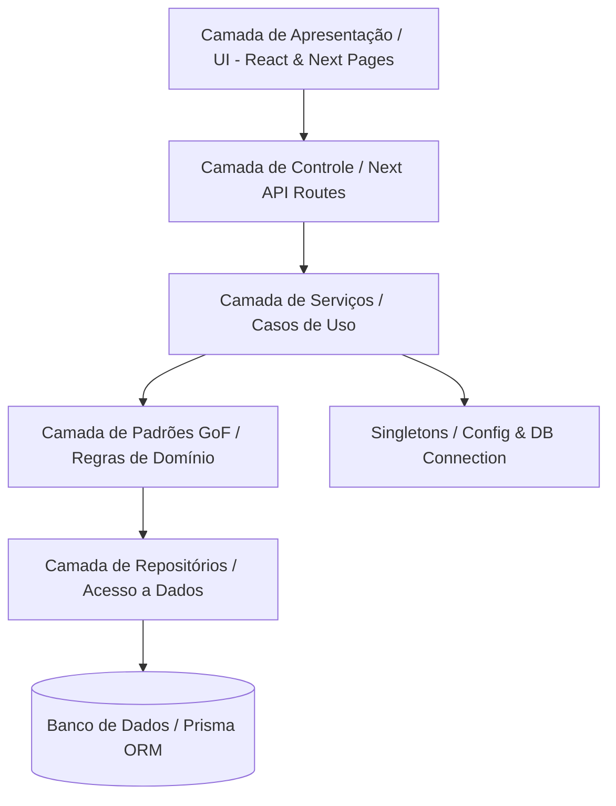
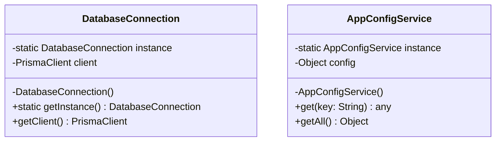
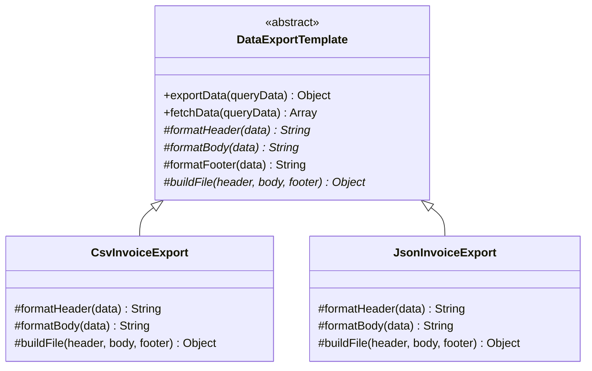
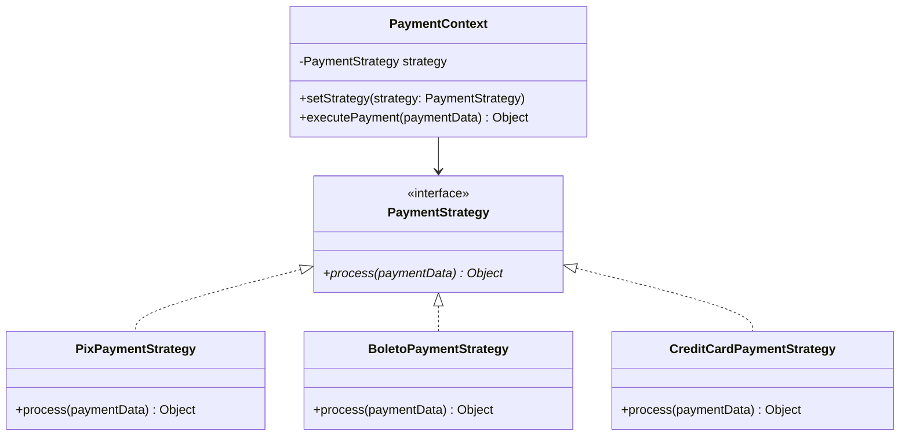
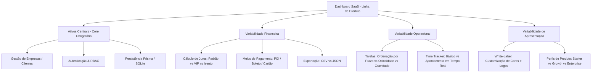

# Documentação de Engenharia de Software e Padrões de Reúso (GoF)

> **Projeto**: Dashboard de Gestão Financeira, Cobranças e Tarefas  
> **Disciplina / Foco**: Engenharia de Software & Reúso de Software  
> **Objetivo**: Transição de código ad-hoc (*vibe coding*) para uma arquitetura modular, manutenível e extensível através de padrões de projeto (GoF) e separação de responsabilidades.

---

## 1. Visão Geral e Arquitetura Proposta

Para elevar a manutenibilidade, testabilidade e potencial de reúso do sistema, a aplicação adota uma **Arquitetura em Camadas (Layered Architecture)** com desacoplamento de infraestrutura, regras de negócio e apresentação.



### Estrutura de Diretórios Recomendada

```text
dashboard-main/
├── core/                      # Regras de negócio puras (Enterprise Business Rules)
│   ├── entities/              # Modelos e validações centrais
│   └── errors/                # Classes de erro de domínio
├── patterns/                  # Catálogo de Design Patterns implementados
│   ├── singleton/             # DatabaseConnection, AppConfigService
│   ├── template-method/       # DataExportTemplate, TaskWorkflowTemplate, InvoiceImporterTemplate
│   └── strategy/              # PaymentStrategy, InterestStrategy, TaskPriorityStrategy
├── services/                  # Casos de uso da aplicação (Application Services)
│   ├── invoiceService.js
│   ├── paymentService.js
│   └── taskService.js
├── repositories/              # Acesso ao banco de dados com Prisma encapsulado
│   ├── invoiceRepository.js
│   └── companyRepository.js
├── pages/api/                 # Controllers HTTP (Next.js API Routes)
└── components/                # Componentes visuais reutilizáveis
```

---

## 1.1. As 10 Classes Principais do Sistema (Requisito 01)

Atendendo à exigência do edital (*"Mas antes vocês devem codificar as principais classes (ao menos 10) com métodos e atributos"*), o sistema implementa 10 entidades ricas de domínio na pasta `core/entities/`, com encapsulamento de atributos privados, validações e métodos de negócio:

| # | Classe de Domínio | Arquivo | Atributos Principais | Métodos de Negócio Chave |
| :-: | :--- | :--- | :--- | :--- |
| **1** | `Company` | `core/entities/Company.js` | `#id`, `#name`, `#cnpj`, `#email`, `#phone`, `#whatsapp`, `#notes`, `#ownerId` | `validateCnpj()`, `formatCnpj()`, `getCleanWhatsApp()`, `isVipClient()`, `toJSON()` |
| **2** | `User` | `core/entities/User.js` | `#id`, `#name`, `#email`, `#role`, `#cpf`, `#phoneNumber` | `isAdmin()`, `hasPermission(action)`, `maskCpf()`, `getInitials()`, `toJSON()` |
| **3** | `Invoice` | `core/entities/Invoice.js` | `#id`, `#companyId`, `#amountCents`, `#dueDate`, `#status`, `#paidAt`, `#isFuture` | `isOverdue()`, `calculateDaysLate()`, `markAsPaid()`, `cancel()`, `getFormattedAmount()` |
| **4** | `Task` | `core/entities/Task.js` | `#id`, `#title`, `#status`, `#priority`, `#dueDate`, `#startedAt`, `#totalTimeWorked` | `start()`, `pause()`, `complete()`, `getFormattedTimeWorked()`, `isUrgent()` |
| **5** | `Payment` | `core/entities/Payment.js` | `#id`, `#userId`, `#amountCents`, `#method`, `#status`, `#type` | `isLiquidated()`, `calculateGatewayFeeCents()`, `getNetRevenueCents()`, `getFormattedAmount()` |
| **6** | `MonthlyFee` | `core/entities/MonthlyFee.js` | `#id`, `#companyId`, `#amountCents`, `#dueDay`, `#dueDate`, `#isActive` | `generateNextDueDate()`, `deactivate()`, `activate()`, `getFormattedAmount()` |
| **7** | `Sale` | `core/entities/Sale.js` | `#id`, `#userId`, `#description`, `#amountCents`, `#createdAt` | `calculateCommissionCents(percent)`, `getFormattedAmount()`, `toJSON()` |
| **8** | `Address` | `core/entities/Address.js` | `#street`, `#number`, `#neighborhood`, `#city`, `#state`, `#zipCode` | `formatCep()`, `formatFullAddress()`, `toJSON()` |
| **9** | `AuditLog` | `core/entities/AuditLog.js` | `#id`, `#entity`, `#entityId`, `#action`, `#performedBy`, `#details`, `#timestamp` | `isRecent(maxMinutes)`, `formatLogEntry()`, `toJSON()` |
| **10** | `SubscriptionPlan` | `core/entities/SubscriptionPlan.js`| `#name`, `#profile`, `#priceCents`, `#features`, `#allowedPaymentMethods` | `hasFeature()`, `canAcceptPaymentMethod()`, `isVipEnterprise()`, `createStarterPlan()`, `createVipEnterprisePlan()` |

Todas as 10 classes são exportadas centralizadamente em `core/index.js`.

---

## 2. Catálogo de Padrões de Projeto (GoF)

---

###  Singleton (2 Exemplos)

O padrão **Singleton** garante que uma classe possua apenas uma única instância durante toda a execução da aplicação e fornece um ponto de acesso global a ela.



#### Exemplo 1: `DatabaseConnection` (Instância Única do Prisma Client)
* **Problema**: Evita que múltiplas conexões com o banco de dados sejam abertas a cada requisição ou recarga no Next.js (hot-reloading).
* **Arquivo**: `patterns/singleton/DatabaseConnection.js`

```javascript
import { PrismaClient } from "@prisma/client";

class DatabaseConnection {
  constructor() {
    if (!DatabaseConnection.instance) {
      this.client = new PrismaClient({
        log: process.env.NODE_ENV === "development" ? ["query", "error", "warn"] : ["error"],
      });
      DatabaseConnection.instance = this;
    }
    return DatabaseConnection.instance;
  }

  getClient() {
    return this.client;
  }
}

const instance = Object.freeze(new DatabaseConnection());
export default instance.getClient();
```

#### Exemplo 2: `AppConfigService` (Gerenciador Central de Configurações)
* **Problema**: Centralizar constantes de negócio, flags de funcionalidades e regras de tolerância em memória com acesso imutável.
* **Arquivo**: `patterns/singleton/AppConfigService.js`

```javascript
class AppConfigService {
  constructor() {
    if (AppConfigService.instance) {
      return AppConfigService.instance;
    }

    this.config = {
      defaultCurrency: "BRL",
      invoiceGracePeriodDays: 5,
      defaultFinePercent: 0.02, // 2% multa
      defaultDailyInterestPercent: 0.00033, // ~1% ao mês proporcional
      environment: process.env.NODE_ENV || "development",
    };

    AppConfigService.instance = this;
    Object.freeze(this);
  }

  get(key) {
    return this.config[key];
  }

  getAll() {
    return { ...this.config };
  }
}

export default new AppConfigService();
```

---

###  Template Method (3 Exemplos)

O padrão **Template Method** define o esqueleto invariante de um algoritmo na superclasse, delegando etapas específicas para as subclasses concretas sem alterar a estrutura global.



#### Exemplo 1: `DataExportTemplate` (Exportação de Relatórios Financeiros)
* **Problema**: A rotina de exportação possui sempre o mesmo fluxo (buscar dados -> cabeçalho -> corpo -> rodapé -> empacotar), mas os formatos (CSV, JSON, XML) geram saídas distintas.
* **Arquivo**: `patterns/template-method/DataExportTemplate.js`

```javascript
export class DataExportTemplate {
  // Template Method: Algoritmo invariante
  async exportData(queryData) {
    const rawData = await this.fetchData(queryData);
    const header = this.formatHeader(rawData);
    const body = this.formatBody(rawData);
    const footer = this.formatFooter(rawData);
    return this.buildFile(header, body, footer);
  }

  async fetchData(queryData) {
    return queryData; // Hook padrão
  }

  // Métodos primitivos que as subclasses devem implementar
  formatHeader(data) { throw new Error("Método formatHeader deve ser implementado."); }
  formatBody(data) { throw new Error("Método formatBody deve ser implementado."); }
  formatFooter(data) { return ""; } // Hook opcional
  buildFile(header, body, footer) { throw new Error("Método buildFile deve ser implementado."); }
}

// Subclasse Concreta 1: Exportador CSV
export class CsvInvoiceExport extends DataExportTemplate {
  formatHeader() {
    return "ID,Empresa,Valor(Centavos),Vencimento,Status\n";
  }

  formatBody(invoices) {
    return invoices.map(i => `${i.id},"${i.companyName}",${i.amountCents},${i.dueDate},${i.status}`).join("\n");
  }

  buildFile(header, body) {
    return { mimeType: "text/csv", content: header + body };
  }
}

// Subclasse Concreta 2: Exportador JSON
export class JsonInvoiceExport extends DataExportTemplate {
  formatHeader() { return ""; }
  formatBody(invoices) { return JSON.stringify(invoices, null, 2); }
  buildFile(header, body) {
    return { mimeType: "application/json", content: body };
  }
}
```

#### Exemplo 2: `TaskWorkflowTemplate` (Transição de Estados de Tarefas)
* **Problema**: Transições de status de tarefas exigem uma ordem obrigatória: validar permissão -> registrar timestamps -> salvar no banco -> disparar eventos/notificações.
* **Arquivo**: `patterns/template-method/TaskWorkflowTemplate.js`

```javascript
export class TaskWorkflowTemplate {
  // Template Method
  async executeTransition(task, user) {
    this.validatePermissions(task, user);
    const updatedData = this.calculateTimestamps(task);
    const savedTask = await this.persistTransition(task.id, updatedData);
    await this.afterTransition(savedTask);
    return savedTask;
  }

  validatePermissions(task, user) {
    if (!user) throw new Error("Acesso negado: Usuário não autenticado.");
  }

  calculateTimestamps(task) { throw new Error("calculateTimestamps obrigatório."); }
  async persistTransition(taskId, data) { throw new Error("persistTransition obrigatório."); }
  async afterTransition(task) { /* Hook opcional */ }
}

// Subclasse: Início da Tarefa
export class StartTaskWorkflow extends TaskWorkflowTemplate {
  calculateTimestamps(task) {
    return {
      status: "EM_ANDAMENTO",
      startedAt: task.startedAt || new Date(),
      lastResumeAt: new Date(),
    };
  }

  async persistTransition(taskId, data) {
    return { id: taskId, ...data };
  }
}

// Subclasse: Conclusão da Tarefa
export class CompleteTaskWorkflow extends TaskWorkflowTemplate {
  calculateTimestamps(task) {
    return {
      status: "CONCLUIDA",
      finishedAt: new Date(),
    };
  }

  async persistTransition(taskId, data) {
    return { id: taskId, ...data };
  }

  async afterTransition(task) {
    console.log(`[Auditoria/Notificação] Tarefa #${task.id} finalizada com sucesso.`);
  }
}
```

#### Exemplo 3: `InvoiceImporterTemplate` (Importação e Processamento de Cobranças)
* **Problema**: Processamento de faturas de origens externas (Spedy, planilhas ou ERPs) seguindo as fases de *parse*, *validação de regras fiscais*, *enriquecimento de dados* e *persistência*.
* **Arquivo**: `patterns/template-method/InvoiceImporterTemplate.js`

```javascript
export class InvoiceImporterTemplate {
  // Template Method
  async processImport(rawPayload) {
    const records = this.parseRecords(rawPayload);
    const validatedRecords = this.validateRecords(records);
    const enrichedRecords = this.enrichRecords(validatedRecords);
    return await this.saveToDatabase(enrichedRecords);
  }

  parseRecords(rawPayload) { throw new Error("parseRecords obrigatório."); }
  validateRecords(records) {
    if (!Array.isArray(records) || records.length === 0) {
      throw new Error("Nenhum registro válido identificado.");
    }
    return records;
  }
  enrichRecords(records) { return records; } // Hook padrão
  async saveToDatabase(records) { throw new Error("saveToDatabase obrigatório."); }
}

// Subclasse para Integração Spedy
export class SpedyInvoiceImporter extends InvoiceImporterTemplate {
  parseRecords(rawPayload) {
    return JSON.parse(rawPayload).invoices;
  }

  enrichRecords(records) {
    return records.map(r => ({
      ...r,
      source: "SPEDY_INTEGRATION",
      importedAt: new Date(),
    }));
  }

  async saveToDatabase(records) {
    return { count: records.length, records };
  }
}
```

---

###  Strategy (3 Exemplos)

O padrão **Strategy** define uma família de algoritmos, encapsula cada um deles e os torna intercambiáveis em tempo de execução, permitindo que o algoritmo varie independentemente dos clientes que o utilizam.



#### Exemplo 1: `InterestCalculationStrategy` (Cálculo de Juros e Multas)
* **Problema**: Regras de cobrança de inadimplência variam por perfil de cliente (Contrato Padrão, VIP, Órgãos Públicos/Isentos).
* **Arquivo**: `patterns/strategy/interestStrategies.js`

```javascript
// Estratégia 1: Padrão (Multa 2% + 0.033% ao dia)
export class StandardInterestStrategy {
  calculate(amountCents, daysLate) {
    if (daysLate <= 0) return amountCents;
    const fine = amountCents * 0.02;
    const dailyInterest = amountCents * (0.00033 * daysLate);
    return Math.round(amountCents + fine + dailyInterest);
  }
}

// Estratégia 2: Cliente VIP / Parceiro (Isenção de multa, juros reduzidos)
export class VipInterestStrategy {
  calculate(amountCents, daysLate) {
    if (daysLate <= 0) return amountCents;
    const dailyInterest = amountCents * (0.00015 * daysLate);
    return Math.round(amountCents + dailyInterest);
  }
}

// Estratégia 3: Isenção Total
export class GracePeriodInterestStrategy {
  calculate(amountCents) {
    return amountCents;
  }
}

// Contexto
export class InvoiceCalculatorContext {
  constructor(strategy = new StandardInterestStrategy()) {
    this.strategy = strategy;
  }

  setStrategy(strategy) {
    this.strategy = strategy;
  }

  getFinalAmount(amountCents, daysLate) {
    return this.strategy.calculate(amountCents, daysLate);
  }
}
```

#### Exemplo 2: `PaymentProcessingStrategy` (Processamento de Meios de Pagamento)
* **Problema**: Processamento de PIX, Boleto e Cartão de Crédito possuem taxas, fluxos de liquidação e retornos completamente distintos.
* **Arquivo**: `patterns/strategy/paymentStrategies.js`

```javascript
export class PixPaymentStrategy {
  async process(paymentData) {
    return {
      method: "PIX",
      status: "PAID",
      transactionId: `PIX-${Date.now()}`,
      feeCents: 0,
      liquidatedImmediately: true,
    };
  }
}

export class BoletoPaymentStrategy {
  async process(paymentData) {
    return {
      method: "BOLETO",
      status: "PENDING",
      barcode: "34191.79001 01043.510047 91020.150008 8 9800000010000",
      feeCents: 250, // R$ 2,50
      liquidatedImmediately: false,
    };
  }
}

export class CreditCardPaymentStrategy {
  async process(paymentData) {
    return {
      method: "CREDIT_CARD",
      status: "PAID",
      authorizationCode: "AUTH-998811",
      feeCents: Math.round(paymentData.amountCents * 0.035), // 3.5%
      liquidatedImmediately: true,
    };
  }
}

// Contexto
export class PaymentService {
  constructor(strategy) {
    this.strategy = strategy;
  }

  setStrategy(strategy) {
    this.strategy = strategy;
  }

  async executePayment(paymentData) {
    return await this.strategy.process(paymentData);
  }
}
```

#### Exemplo 3: `TaskPriorityScoringStrategy` (Critérios de Ordenação de Tarefas)
* **Problema**: O quadro de tarefas precisa ser reordenado dinamicamente com base em diferentes prioridades: *prazo de entrega*, *tempo ocioso na fila* ou *gravidade do status*.
* **Arquivo**: `patterns/strategy/taskPriorityStrategies.js`

```javascript
// Estratégia 1: Ordenação por Data de Vencimento
export class DueDatePriorityStrategy {
  sort(tasks) {
    return [...tasks].sort((a, b) => new Date(a.dueDate) - new Date(b.dueDate));
  }
}

// Estratégia 2: Ordenação por Tempo de Inatividade (Gargalos)
export class IdleTimePriorityStrategy {
  sort(tasks) {
    return [...tasks].sort((a, b) => {
      const waitA = Date.now() - new Date(a.createdAt).getTime();
      const waitB = Date.now() - new Date(b.createdAt).getTime();
      return waitB - waitA;
    });
  }
}

// Estratégia 3: Ordenação por Gravidade
export class SeverityPriorityStrategy {
  sort(tasks) {
    const weights = { ALTA: 3, MEDIA: 2, BAIXA: 1 };
    return [...tasks].sort((a, b) => (weights[b.priority] || 0) - (weights[a.priority] || 0));
  }
}
```

---

## 3. Matriz de Reúso e Princípios de Engenharia (SOLID)

| Padrão GoF | Ponto de Variabilidade no Sistema | Princípio SOLID Principal | Benefício de Reúso Obtido |
| :--- | :--- | :--- | :--- |
| **Singleton (Database)** | Gerenciamento de pool e conexão com banco | **SRP** (Single Responsibility) | Evita vazamento de memória e concorrência descontrolada de conexões no Prisma. |
| **Singleton (Config)** | Parâmetros globais de negócio e ambiente | **DRY** (Don't Repeat Yourself) | Elimina redundância e inconsistência de configurações espalhadas no código. |
| **Template Method (Export)** | Formatos de saída de relatórios (CSV, JSON) | **OCP** (Open/Closed Principle) | Reúso de 100% da lógica de query e orquestração de arquivos ao adicionar novos formatos. |
| **Template Method (Task)** | Ciclo de vida e transições de tarefas | **DIP** (Dependency Inversion) | Garante auditoria e integridade invariante em qualquer mudança de estado. |
| **Template Method (Import)** | Processamento em lote de cobranças/faturas | **OCP** / **SRP** | Isola regras de parsing de integrações externas sem duplicar rotinas de banco. |
| **Strategy (Interest)** | Fórmulas de juros e multas financeiras | **OCP** / **LSP** | Adição de novos perfis tributários/comerciais sem alterar as rotinas de faturamento. |
| **Strategy (Payment)** | Gateways e meios de liquidação | **OCP** / **ISP** | Permite plugar novas formas de pagamento (ex: MercadoPago, Stripe) dinamicamente. |
| **Strategy (Task Priority)**| Critérios de priorização do Kanban | **OCP** | Permite alterar a visualização e inteligência de filas na UI sem acoplamento. |

---

## 4. Matriz de Distribuição da Equipe (4 Integrantes × 2 Telas CRUD = 8 Telas)

Para atender ao requisito da disciplina (*"Mínimo de 2 telas CRUD por integrante conectadas ao banco de dados"*), a equipe de **4 integrantes** possui a seguinte divisão de responsabilidades:

| Integrante | Módulo / Escopo | Tela 1 (CRUD) | Tela 2 (CRUD) | Tabelas Envolvidas |
| :--- | :--- | :--- | :--- | :--- |
| **Integrante 1** | **CRM & Gestão de Acessos** | **Empresas / Clientes** (`/admin/companies`)<br>• CRUD completo de clientes, CNPJ, contatos. | **Usuários & Equipe** (`/admin/users`)<br>• CRUD de colaboradores, senhas e papéis (RBAC). | `Company`, `User` |
| **Integrante 2** | **Faturamento & Previsibilidade** | **Faturas Atuais** (`/admin/invoice`)<br>• Emissão, listagem, cancelamento e exportação. | **Recebíveis Futuros** (`/admin/futures`)<br>• Projeção e agendamento de faturas futuras. | `Invoice`, `MonthlyFee` |
| **Integrante 3** | **Cobrança & Liquidação** | **Inadimplentes** (`/admin/inadimplentes`)<br>• Débitos vencidos e recálculo de juros (*Strategy*). | **Conciliação de Pagamentos** (`/admin/pagamentos`)<br>• Liquidação PIX, Boleto e Cartão de Crédito. | `Invoice`, `Payment` |
| **Integrante 4** | **Operacional & Lançamento de Vendas**| **Tarefas & Time Tracker** (`/admin/tarefas`)<br>• Kanban, status com *Template Method* e horas. | **Gestão de Vendas & Entradas** (`/admin/finance`)<br>• Lançamento manual de pedidos e comissões. | `Task`, `Sale`, `Payment` |

> 💡 **Tela Mestra de Reúso (LPS)**: Além das 8 telas individuais de CRUD, a equipe compartilha a tela **`/admin/variabilidade`**, que funciona como o *Configurador de Produtos da Linha de Software*.

---

## 5. Mapeamento das Tabelas do Banco de Dados (Prisma ORM)

O sistema utiliza **7 tabelas relacionais** (superando o requisito mínimo de 3 tabelas):

1. **`Company`**: Cadastro de empresas clientes, dados fiscais (CNPJ, endereço) e vínculos de CS/Vendedor.
2. **`User`**: Operadores, administradores e assinantes com autenticação segura e papéis de permissão.
3. **`Invoice`**: Faturas emitidas, status de pagamento (`PENDING`, `PAID`, `OVERDUE`, `CANCELED`), valores em centavos e flag `isFuture`.
4. **`MonthlyFee`**: Contratos de mensalidades recorrentes por empresa cliente com dia de vencimento fixo.
5. **`Payment`**: Histórico detalhado de transações liquidadas com método (`PIX`, `BOLETO`, `CREDIT_CARD`) e vínculos a faturas/vendas.
6. **`Task`**: Tarefas operacionais com prioridade (`ALTA`, `MEDIA`, `BAIXA`), responsável e apontamento de tempo trabalhado (`totalTimeWorked`).
7. **`Sale`**: Registro de vendas avulsas e comissões associadas aos operadores/vendedores.

---

## 6. Planejamento de Variabilidade e Linha de Produto de Software (LPS)

### A. Modelo de Características (Feature Model)



### B. Tabela de Pontos de Variação (Variation Points)

| Ponto de Variação (VP) | Tipo de Variabilidade | Variantes Disponíveis | Mecanismo de Implementação | Tempo de Ligação (*Binding Time*) |
| :--- | :--- | :--- | :--- | :--- |
| **VP1: Regra de Juros de Inadimplência** | **Alternativa (1 de N)** | • Padrão (Multa 2% + 1% a.m.)<br>• VIP (Juros reduzidos sem multa)<br>• Isento (Tolerância total) | **Strategy Pattern** no Backend (`interestStrategies.js`) | Tempo de Execução (*Runtime*) |
| **VP2: Liquidação de Cobranças** | **OR (1 ou mais)** | • PIX (Instantâneo)<br>• Boleto Bancário<br>• Cartão de Crédito | **Strategy Pattern** no Backend (`paymentStrategies.js`) | Tempo de Execução (*Runtime*) |
| **VP3: Formato de Exportação** | **Alternativa** | • CSV Tabular<br>• JSON Estruturado | **Template Method** (`DataExportTemplate.js`) | Tempo de Execução (*Runtime*) |
| **VP4: Ciclo de Vida de Tarefas** | **Obrigatório com Hooks** | • Início de Tarefa<br>• Pausa com Cálculo de Horas<br>• Conclusão com Notificação | **Template Method** (`TaskWorkflowTemplate.js`) | Tempo de Compilação/Execução |
| **VP5: Perfil do Produto & Colunas Condicionais** | **Inclusão/Exclusão (Feature Toggle)** | • **Starter**: Oculta módulo comercial (CS/Vendedor)<br>• **Growth**: Habilita colunas com CS e Vendedor vinculados<br>• **VIP Enterprise**: Gestão comercial completa + Split Pix | **Feature Toggles em Produção** em `/admin/companies` + Simulador Geral em `/admin/variabilidade` | Tempo de Configuração (*Runtime via UI/Storage*) |

### C. Implementação Concreta da Variabilidade (Exemplo Prático em Código Real)

Para atender a exigência de **não deixar a variabilidade apenas no planejamento conceitual**, uma das variações foi desenvolvida e conectada diretamente à tela operacional de **Gestão de Empresas (`/admin/companies`)**:

1. **Localização no Código**:
   - `pages/admin/companies/index.js`: Gerencia o estado de perfil `lpsProfile` (`STARTER`, `GROWTH`, `VIP`) com persistência no `localStorage`.
   - `components/CompaniesHeader.jsx`: Apresenta o seletor visual de perfil LPS no cabeçalho com badges interativas.
   - `components/CompaniesTable.jsx`: Executa a lógica de variação renderizando condicionalmente o banner explicativo, os cabeçalhos (`<th>`) de **CS Responsável** e **Vendedor**, e as células (`<td>`) com dados reais obtidos do banco de dados (relacionamento `cs` e `seller` no Prisma).
2. **Comportamento em Tempo de Execução**:
   - Ao selecionar **Starter (PME)**: O sistema oculta as colunas comerciais, simplificando a interface para pequenas operações.
   - Ao selecionar **Growth** ou **VIP Enterprise**: O sistema injeta dinamicamente as colunas de **CS Responsável** e **Vendedor**, com badges de status de atribuição.

### D. Perfis de Produtos Derivados da LPS

A partir da base de código única, o sistema deriva **3 produtos comerciais distintos**:

1. **Produto 1: Starter (PME / Autônomo)**
   - *Features ativas*: Empresas (`Company`) com visão simplificada (sem CS/Vendedor), Faturas básicas (`Invoice`), Exportação CSV.
   - *Finalidade*: Solução enxuta para pequenos prestadores de serviço com custo mínimo de infraestrutura.
2. **Produto 2: Growth (Médias Empresas)**
   - *Features ativas*: Starter + Módulo Comercial em Empresas (CS e Vendedor vinculados) + Quadro de Tarefas (`Task`) com workflow estruturado + Gestão de Inadimplência com régua de cobrança e Faturas Futuras (`futures`).
   - *Finalidade*: Empresas em expansão que necessitam de previsibilidade financeira e controle operacional.
3. **Produto 3: VIP Enterprise (Grandes Operações / Eventos)**
   - *Features ativas*: Growth + Múltiplos meios de pagamento (PIX, Boleto, Cartão), regras de juros especiais para clientes VIP, split de recebíveis, personalização White-Label e exportação JSON/APIs.
   - *Finalidade*: Grandes clientes corporativos com demandas de integração e regras contratuais customizadas.


   Anotações
   As telas que aparecem exatamente no seu menu lateral (conforme o print que você enviou) são as seguintes:

1. 🏢 Empresas
Rota: http://localhost:3000/admin/companies
Arquivo: 

pages/admin/companies/index.js
Tabela no Banco: Company
O que faz (CRUD): Cadastrar novas empresas/clientes, listar empresas em tabela com busca rápida, editar contatos/CNPJ e excluir empresas.
Divisão: 👤 Integrante 1
2. 👤 Usuários
Rota: http://localhost:3000/admin/users
Arquivo: 

pages/admin/users/index.js
Tabela no Banco: User
O que faz (CRUD): Cadastrar operadores/colaboradores, listar equipe, definir papéis de acesso (ADMIN, SUBSCRIBER), trocar senhas e suspender/desativar usuários.
Divisão: 👤 Integrante 1
3. 🧾 Cobrança (Invoices)
Rota: http://localhost:3000/admin/invoice
Arquivo: 

pages/admin/invoice/index.js
Tabela no Banco: Invoice
O que faz (CRUD): Gerar faturas, visualizar cobranças no calendário interativo, marcar faturas como pagas, cancelar e exportar relatórios (CSV/JSON com Template Method).
Divisão: 👤 Integrante 2
4. 📅 Futuros (Recebíveis Futuros)
Rota: http://localhost:3000/admin/futures
Arquivo: 

pages/admin/futures/index.js
Tabelas no Banco: Invoice (filtro isFuture: true) e MonthlyFee
O que faz (CRUD): Cadastrar previsões de receitas futuras por cliente, listar faturas programadas para os próximos 6 meses, editar valores/vencimentos futuros e cancelar lançamentos futuros.
Divisão: 👤 Integrante 2
5. ⚠️ Inadimplentes
Rota: http://localhost:3000/admin/inadimplentes
Arquivo: 

pages/admin/inadimplentes/index.js
Tabelas no Banco: Invoice (status OVERDUE) e Company
O que faz (CRUD): Painel exclusivo de clientes com dívidas em atraso. Calcula juros/multas automáticos com o padrão Strategy (interestStrategies.js), permite renegociar faturas e prorrogar prazos de vencimento.
Divisão: 👤 Integrante 3
6. 💳 Pagamentos
Rota: http://localhost:3000/admin/pagamentos
Arquivo: 

pages/admin/pagamentos/index.js
Tabela no Banco: Payment
O que faz (CRUD): Criar lançamentos de pagamento, listar histórico detalhado por método de pagamento (PIX, Boleto, Cartão de Crédito com PaymentStrategy), conciliar com faturas e estornar transações.
Divisão: 👤 Integrante 3
7. 📋 Tarefas
Rota: http://localhost:3000/admin/tarefas
Arquivo: 

pages/admin/tarefas/index.js
Tabela no Banco: Task
O que faz (CRUD): Criar tarefas da equipe, atribuir responsáveis, mudar status no fluxo (Iniciar / Pausar / Concluir com cálculo de horas trabalhadas via TaskWorkflowTemplate) e reordenar por prioridade (Strategy).
Divisão: 👤 Integrante 4
8. 💼 Financeiro
Rota: http://localhost:3000/admin/finance
Arquivo: 

pages/admin/finance/index.js
Tabelas no Banco: Sale e Payment
O que faz (CRUD): Registrar pedidos manuais e vendas avulsas, listar entradas financeiras totais por período (7 dias, 30 dias, anual), calcular comissões de vendedores e excluir/editar vendas.
Divisão: 👤 Integrante 4
📊 Telas Adicionais do Sistema:
🏠 Dashboard (/admin/dashboard): Tela de visão executiva agregando os cards de faturamento, total de empresas e métricas gerais.
🧩 Variabilidade (/admin/variabilidade): O Configurador de Linha de Produto de Software (LPS), onde vocês alternam ao vivo entre os produtos derivados (Starter, Growth, VIP).