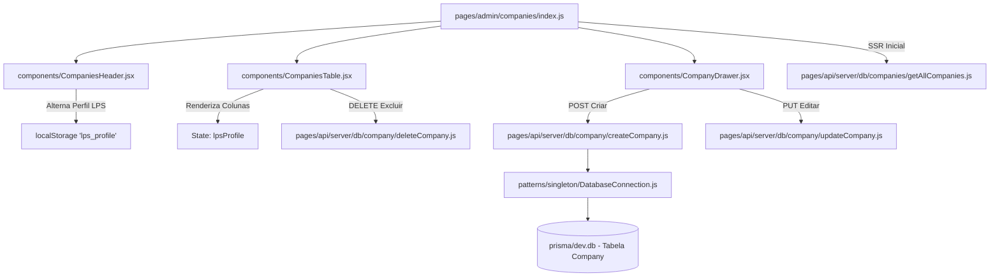

# 📘 Roteiro de Apresentação — Integrante 1: Matheus
**Módulo:** CRM, Gestão de Usuários e Variabilidade Real da Linha de Produto de Software (LPS)  
**Projeto:** Reuso_med (Engenharia de Reúso de Software)  
**Data da Avaliação:** 16/10/2026

---

## 1. Visão Geral das Responsabilidades

Você é o responsável pelo **núcleo de cadastro institucional (CRM e Acessos)** e pela demonstração da **Variabilidade em Código Real da Linha de Produto de Software (LPS)**.

| Recurso | Detalhes |
| :--- | :--- |
| **Tela 1 (CRUD)** | **Gestão de Empresas / Clientes** (`http://localhost:3000/admin/companies`) |
| **Tela 2 (CRUD)** | **Usuários & Equipe** (`http://localhost:3000/admin/users`) |
| **Tabelas do Banco (Prisma)** | `Company`, `User` |
| **Padrão / Conceito de Reúso** | **Variabilidade da LPS em Tempo Real (VP5)** + **10 Classes de Domínio** (`core/entities/`) |

---

## 2. Detalhamento da Tela 1: Gestão de Empresas (`/admin/companies`)

### A. O que a tela faz:
1. **Listagem e Busca Dinâmica**: Exibe todas as empresas cadastradas no banco SQLite, com filtro instantâneo por Nome, Razão Social, E-mail ou CNPJ.
2. **Cadastro (Create)**: Drawer lateral (`CompanyDrawer.jsx`) para cadastrar novas empresas com validação de CNPJ, endereço e plano de mensalidade inicial.
3. **Edição (Update)**: Permite alterar dados de contato, endereço, CS responsável e vendedor atribuído.
4. **Exclusão (Delete)**: Modal de confirmação para inativar ou remover empresas da base de dados.
5. **Variabilidade LPS (Feature Toggle em Produção)**: Seletor no topo da tela com 3 perfis:
   - **Starter (PME)**: Oculta colunas comerciais, entregando uma interface limpa para clientes menores.
   - **Growth / VIP Enterprise**: Injeta dinamicamente as colunas de **CS Responsável** e **Vendedor**, exibindo os dados relacionais do banco.

### B. Fluxo Completo de Arquivos (Da Interface ao Banco):

1. **Camada de Apresentação (Frontend)**:
   - `pages/admin/companies/index.js`: Gerencia o estado central da página, o hook `useCompaniesPage` e o estado da LPS (`lpsProfile`).
   - `components/CompaniesHeader.jsx`: Contém a barra de pesquisa, botão "Nova Empresa" e o **Seletor de Perfis LPS** (`Starter`, `Growth`, `VIP`).
   - `components/CompaniesTable.jsx`: Tabela dinâmica que lê `lpsProfile` e decide se renderiza as colunas de CS e Vendedor, além de exibir o badge de status e botões de ação.
   - `components/CompanyDrawer.jsx`: Formulário offcanvas para preenchimento de Razão Social, CNPJ, Telefone e seleção de Vendedor/CS.
2. **Camada de Controle e API (Backend Next.js)**:
   - `pages/api/server/db/companies/getAllCompanies.js`: Faz a consulta relacional incluindo `cs` e `seller` para alimentar o SSR e a tabela.
   - `pages/api/server/db/company/createCompany.js`: Valida o payload, trata formatação de telefone/CNPJ e insere no banco via transação do Prisma.
   - `pages/api/server/db/company/updateCompany.js`: Atualiza os campos editados.
3. **Camada de Padrões e Persistência**:
   - `patterns/singleton/DatabaseConnection.js`: Fornece a instância única do Prisma Client para as APIs.
   - `core/entities/Company.js`: Classe de domínio que encapsula as regras de negócio de empresas (validação de CNPJ, formatação de endereço e cálculo de dias ativo).
   - `prisma/schema.prisma` (modelo `Company`) e banco SQLite (`prisma/dev.db`).

---

## 3. Detalhamento da Tela 2: Usuários & Equipe (`/admin/users`)

### A. O que a tela faz:
1. **Listagem de Usuários**: Tabela com todos os operadores, administradores e clientes assinantes do sistema.
2. **Controle de Papéis (RBAC)**: Visualização de permissões com base no enum `Role` (`ADMIN`, `SUBSCRIBER`, `SELLER`, `CS`).
3. **Criação e Gestão de Credenciais**: Adicionar colaboradores com geração segura de hash de senha (`bcryptjs`).
4. **Vínculo Comercial**: Os usuários cadastrados aqui aparecem como opções de seleção para **CS Responsável** e **Vendedor** na tela de Empresas.

### B. Fluxo Completo de Arquivos:
1. **Frontend**: `pages/admin/users/index.js` renderiza os cards de equipe e tabela de colaboradores.
2. **API**: `pages/api/server/db/users/getAllUsers.js` busca todos os usuários ordenados por nome.
3. **Segurança / Auth**: `pages/api/auth/[...nextauth].js` e `pages/api/user/checkCredentials.js` autenticam via JWT e comparam senhas usando `bcrypt.compare`.
4. **Domínio**: `core/entities/User.js` modela o colaborador com métodos `isAdmin()`, `hasRole()` e validação de e-mail.
5. **Persistência**: Tabela `User` no SQLite via `DatabaseConnection.js`.

---

## 4. O que Defender sobre Engenharia de Reúso (Padrões & LPS)

### 1. Ponto de Variação em Tempo de Execução (LPS VP5)
- **Problema de Reúso:** Como atender simultaneamente clientes pequenos (Starter) que só querem cadastros simples e clientes grandes (Growth/VIP) que exigem equipe de vendas e CS, sem criar dois sistemas separados?
- **Solução Aplicada:** Utilizamos **Feature Toggles** controlados por estado e `localStorage` no próprio componente de tabela. O mesmo componente `CompaniesTable.jsx` é reutilizado em 100% dos produtos derivados da LPS, adaptando sua estrutura tabular condicionalmente.

### 2. Ativos Centrais de Domínio (10 Classes Core)
- Você pode citar que antes do desenvolvimento dos CRUDs, a equipe codificou as **10 classes de domínio** com atributos privados e métodos de negócio em `core/entities/` (`Company.js`, `User.js`, `Invoice.js`, `Task.js`, etc.), servindo de ativos centrais (*Core Assets*) reutilizáveis em qualquer parte da aplicação.

---

## 5. Script de Apresentação (O que falar na banca)

> *"Bom dia/Boa tarde, professor. Eu sou o Matheus e fui responsável pelo módulo de CRM e Gestão de Usuários, além da coordenação da Linha de Produto de Software (LPS).*
>
> *(Abrir a tela `/admin/companies` no navegador)*  
> *Aqui na tela de Empresas temos o CRUD completo de clientes conectados ao banco SQLite via Prisma ORM. O usuário pode cadastrar, buscar, editar contatos e vincular vendedores.*
>
> *O grande diferencial de reúso desta tela é a **Variabilidade da LPS na prática**: perceba estes botões no topo. Quando seleciono o perfil **Starter**, a interface oculta as colunas comerciais para simplificar o uso para autônomos. Quando alterno para **Growth ou VIP**, a mesma tabela se reconfigura dinamicamente e injeta as colunas de **CS Responsável** e **Vendedor**, buscando os relacionamentos reais salvos no banco.*
>
> *(Abrir a tela `/admin/users` no navegador)*  
> *Na tela de Usuários, temos a gestão de permissões RBAC onde cadastramos os administradores e vendedores com senhas criptografadas em bcrypt. Esses usuários são exatamente os que alimentam as opções de vendedores e CS na tela de empresas.*
>
> *Para garantir a manutenibilidade, todas as entidades foram estruturadas em classes de domínio centrais dentro da pasta `core/`, promovendo o desacoplamento da lógica de negócio em relação ao framework."*
