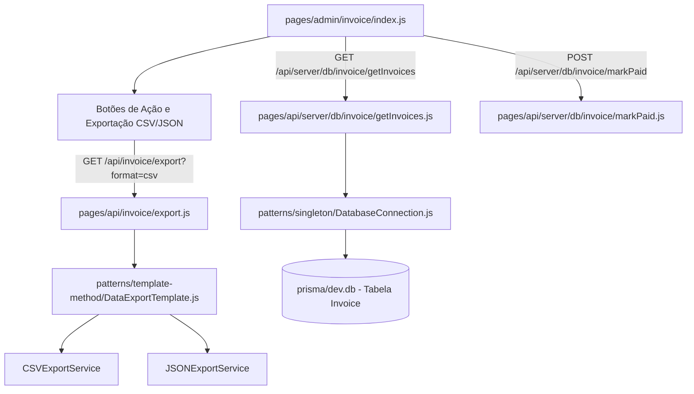

# 📘 Roteiro de Apresentação — Integrante 2
**Módulo:** Faturamento, Previsão Financeira e Template Method de Exportação  
**Projeto:** Reuso_med (Engenharia de Reúso de Software)  
**Data da Avaliação:** 16/10/2026

---

## 1. Visão Geral das Responsabilidades

Você é o responsável pelo módulo de **Emissão de Cobranças e Planejamento de Receita Futura**, e pela demonstração do padrão GoF **Template Method** aplicado à exportação de relatórios.

| Recurso | Detalhes |
| :--- | :--- |
| **Tela 1 (CRUD)** | **Cobrança / Invoices** (`http://localhost:3000/admin/invoice`) |
| **Tela 2 (CRUD)** | **Recebíveis Futuros** (`http://localhost:3000/admin/futures`) |
| **Tabelas do Banco (Prisma)** | `Invoice`, `MonthlyFee` |
| **Padrão GoF Principal** | **Template Method** (`patterns/template-method/DataExportTemplate.js`) |

---

## 2. Detalhamento da Tela 1: Cobrança / Invoices (`/admin/invoice`)

### A. O que a tela faz:
1. **Listagem e Visão Dupla**: Permite alternar entre **Visão em Tabela** e **Visão em Calendário Interativo** (FullCalendar), facilitando a visualização dos vencimentos do mês.
2. **Filtros e Busca**: Filtra faturas por período (Mês/Ano), por status (`PENDING`, `PAID`, `OVERDUE`, `CANCELED`) e por empresa cliente.
3. **Liquidação Manual (Update)**: Ação para marcar faturas pendentes como pagas (`markPaid.js`), gravando data de liquidação e atualizando status.
4. **Cancelamento (Delete/Update)**: Possibilidade de cancelar cobranças indevidas ou emitidas por engano.
5. **Exportação de Dados com Template Method**: Botões no cabeçalho para download instantâneo em **CSV** e **JSON**.

### B. Fluxo Completo de Arquivos (Da Interface ao Banco):

1. **Frontend**:
   - `pages/admin/invoice/index.js`: Controla o calendário, lista de faturas, modais de detalhes e a barra de exportação.
2. **Backend / APIs**:
   - `pages/api/server/db/invoice/getInvoices.js`: Busca as faturas filtradas pelo mês e ano selecionados, incluindo dados da empresa (`Company`).
   - `pages/api/server/db/invoice/markPaid.js`: Atualiza o status da fatura para `PAID` e preenche `paidAt = new Date()`.
   - `pages/api/server/db/invoice/cancelCompanyInvoices.js`: Cancela faturas vinculadas.
   - `pages/api/invoice/export.js`: Endpoint que instancia a classe de exportação de acordo com o parâmetro `format`.
3. **Padrão GoF Template Method**:
   - `patterns/template-method/DataExportTemplate.js`:
     - O método esqueleto `exportData(filters)` executa: `fetchData()` ➔ `validateData()` ➔ `formatData()` ➔ `buildResponse()`.
     - Subclasse `CSVExportService`: Formata os dados no padrão tabular delimitado por vírgula e define `Content-Type: text/csv`.
     - Subclasse `JSONExportService`: Formata os dados estruturados com metadados de auditoria e define `Content-Type: application/json`.
4. **Banco de Dados**: Tabela `Invoice` e `MonthlyFee` no SQLite via `DatabaseConnection.js`.

---

## 3. Detalhamento da Tela 2: Recebíveis Futuros (`/admin/futures`)

### A. O que a tela faz:
1. **Projeção de Receita Recorrente**: Lista as previsões de mensalidades dos próximos 6 a 12 meses geradas a partir dos contratos ativos (`MonthlyFee`).
2. **Cadastro e Agendamento**: Permite gerar lançamentos futuros programados para clientes com contratos fechados.
3. **Edição de Vencimentos Futuros**: Ajustar datas ou valores de faturas projetadas caso haja renegociação de contrato antes da virada do mês.
4. **Cancelamento de Recorrência**: Cancela previsões futuras se o contrato do cliente for encerrado antes do prazo.

### B. Fluxo Completo de Arquivos:
1. **Frontend**: `pages/admin/futures/index.js` exibe as métricas de receita projetada e a tabela de parcelas futuras.
2. **APIs**:
   - `pages/api/server/db/invoice/getFutureInvoices.js`: Busca cobranças onde `isFuture = true` ou geradas dinamicamente a partir de `MonthlyFee`.
   - `pages/api/server/db/invoice/futureInvoice.js`: Cria ou atualiza lançamentos futuros.
   - `pages/api/server/db/invoice/cancelFutureMonthlyFees.js`: Remove o agendamento de parcelas futuras.
3. **Domínio**: `core/entities/MonthlyFee.js` e `core/entities/Invoice.js` validam datas futuras e cálculo de competência (`periodMonth`, `periodYear`).
4. **Persistência**: Tabelas `Invoice` e `MonthlyFee` no SQLite.

---

## 4. O que Defender sobre o Padrão GoF Template Method

- **Nome do Padrão:** Template Method (Padrão Comportamental GoF).
- **Problema de Reúso:** A exportação de dados para relatórios exige sempre as mesmas etapas (autenticação, busca no banco, validação e envio de headers HTTP). Se fizéssemos um script para CSV e outro para JSON, duplicaríamos 80% do código.
- **Solução:** Criamos a classe abstrata `DataExportTemplate`. O método principal `exportData()` é o *template method* invariante que orquestra o fluxo. As subclasses concretas apenas sobrescrevem os métodos gancho (*hooks*) `formatData()` e `buildResponse()`.
- **Benefício de Reúso:** Facilidade de adicionar novos formatos no futuro (como XML ou Excel) sem mexer em uma linha do fluxo de busca ou validação.

---

## 5. Script de Apresentação (O que falar na banca)

> *"Bom dia/Boa tarde, professor. Eu sou o Integrante 2 e fiquei encarregado do módulo de Faturamento e Previsibilidade Financeira, além da implementação do padrão GoF **Template Method** para exportação de dados.*
>
> *(Abrir a tela `/admin/invoice` no navegador)*  
> *Na tela de Cobrança temos o gerenciamento completo de faturas. Conseguimos alternar entre visão tabular e o calendário interativo, marcar cobranças como pagas e cancelar títulos indevidos, tudo conectado à tabela `Invoice` do banco SQLite.*
>
> *Aqui no topo temos os botões de **Exportar CSV** e **Exportar JSON**. Por trás desses botões está o padrão **Template Method** implementado no arquivo `DataExportTemplate.js`. A classe base define o algoritmo invariante de validação e busca no banco, enquanto as subclasses `CSVExportService` e `JSONExportService` cuidam exclusivamente da formatação do formato específico. Isso evita duplicação de regras de negócio.*
>
> *(Abrir a tela `/admin/futures` no navegador)*  
> *Já na tela de Recebíveis Futuros, trabalhamos com a tabela `MonthlyFee` para projetar o fluxo de caixa dos próximos meses. Conseguimos cadastrar previsões contratuais, editar datas de competência futura e cancelar recorrências programadas caso um contrato seja rescindido."*
