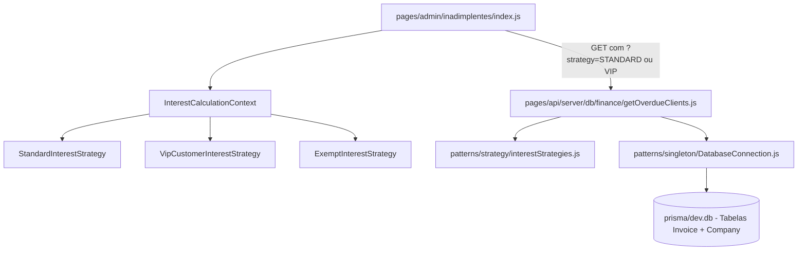

# 📘 Roteiro de Apresentação — Integrante 3
**Módulo:** Cobrança de Inadimplência, Conciliação e Padrão Strategy  
**Projeto:** Reuso_med (Engenharia de Reúso de Software)  
**Data da Avaliação:** 16/10/2026

---

## 1. Visão Geral das Responsabilidades

Você é o responsável pelo módulo de **Recuperação de Crédito (Inadimplência) e Conciliação de Pagamentos**, e pela demonstração do padrão GoF **Strategy** aplicado ao cálculo dinâmico de juros e meios de liquidação.

| Recurso | Detalhes |
| :--- | :--- |
| **Tela 1 (CRUD)** | **Inadimplentes** (`http://localhost:3000/admin/inadimplentes`) |
| **Tela 2 (CRUD)** | **Conciliação de Pagamentos** (`http://localhost:3000/admin/pagamentos`) |
| **Tabelas do Banco (Prisma)** | `Invoice`, `Payment`, `Company` |
| **Padrão GoF Principal** | **Strategy Pattern** (`patterns/strategy/interestStrategies.js` e `paymentStrategies.js`) |

---

## 2. Detalhamento da Tela 1: Inadimplentes (`/admin/inadimplentes`)

### A. O que a tela faz:
1. **Painel de Débitos Vencidos**: Lista automaticamente todas as empresas clientes com faturas em atraso (`status = OVERDUE` ou vencidas no banco).
2. **Cálculo de Juros em Tempo Real com Strategy**:
   - Permite alternar a estratégia de cálculo entre:
     - **Padrão (Standard)**: Aplica multa de 2% mais juros de 1% ao mês proporcional aos dias de atraso.
     - **Cliente VIP**: Aplica taxa bonificada de 0.5% ao mês com isenção total de multa.
     - **Isenção Total**: Zera encargos para negociações amigáveis.
   - O painel exibe a dívida original, o valor dos juros calculados e a dívida final consolidada.
3. **Pílula de Resumo Executivo**: Total de clientes em atraso e valor total acumulado da dívida atualizado conforme a estratégia escolhida.
4. **Acionamento de Cobrança**: Botão de envio rápido via WhatsApp com a mensagem formatada já contendo o valor corrigido pelos juros da estratégia ativa.

### B. Fluxo Completo de Arquivos:

1. **Frontend**: `pages/admin/inadimplentes/index.js` gerencia a interface, os botões de seleção de estratégia e renderiza os valores originais vs. corrigidos.
2. **Backend**: `pages/api/server/db/finance/getOverdueClients.js` busca faturas vencidas no SQLite, instancia o contexto de Strategy e processa cada dívida antes de retornar a resposta.
3. **Padrão Strategy**: `patterns/strategy/interestStrategies.js` implementa as classes `StandardInterestStrategy`, `VipCustomerInterestStrategy` e `InterestCalculationContext`.
4. **Banco de Dados**: Consulta as tabelas `Invoice` e `Company` via Prisma Client.

---

## 3. Detalhamento da Tela 2: Conciliação de Pagamentos (`/admin/pagamentos`)

### A. O que a tela faz:
1. **Histórico de Transações**: Lista todos os pagamentos efetuados e pendentes no sistema, com data, valor e empresa pagadora.
2. **Filtros por Meio de Pagamento**: Filtragem por **PIX**, **Boleto Bancário** e **Cartão de Crédito**.
3. **Novo Pagamento (Create)**: Modal de lançamento que aciona as estratégias de processamento de pagamento.
4. **Vínculo com Faturas**: Ao liquidar um pagamento com sucesso, a respectiva fatura (`Invoice`) é automaticamente atualizada para `PAID`.

### B. Fluxo Completo de Arquivos:
1. **Frontend**: `pages/admin/pagamentos/index.js` renderiza a tabela de pagamentos com status badges e botões de ação.
2. **API**: `pages/api/orders/create-manual.js` recebe os dados do pagamento e valida valores em centavos.
3. **Camada de Serviço & Repositório**:
   - `services/paymentService.js`: Orquestra a execução da estratégia correta via `getStrategyForMethod(method)`.
   - `repositories/paymentRepository.js`: Realiza a persistência relacional do pagamento no Prisma (`connect: { id: companyId }`).
4. **Padrão Strategy**: `patterns/strategy/paymentStrategies.js` com `PixPaymentStrategy`, `BoletoPaymentStrategy` e `CreditCardPaymentStrategy`.
5. **Persistência**: Tabela `Payment` no SQLite.

---

## 4. O que Defender sobre o Padrão GoF Strategy

- **Nome do Padrão:** Strategy (Padrão Comportamental GoF).
- **Problema de Reúso:** Métodos de cálculo de juros e regras de liquidação variam frequentemente de acordo com contratos de clientes (clientes comuns vs. VIPs vs. acordos judiciais). Se usássemos `if/else` ou `switch/case` espalhados no código, qualquer nova regra quebraria o princípio Open/Closed (OCP) do SOLID.
- **Solução:** Isolamos cada família de algoritmos em classes que implementam a mesma interface (`InterestStrategy` e `PaymentStrategy`). O cliente (`Context`) apenas delega o cálculo para a estratégia injetada em tempo de execução.
- **Benefício de Reúso:** Podemos plugar qualquer nova regra contratual ou provedor de pagamento sem alterar a tela ou o controlador da API.

---

## 5. Script de Apresentação (O que falar na banca)

> *"Bom dia/Boa tarde, professor. Eu sou o Integrante 3 e fiquei responsável pela gestão de Inadimplência e Conciliação de Pagamentos, além da aplicação prática do padrão GoF **Strategy**.*
>
> *(Abrir a tela `/admin/inadimplentes` no navegador)*  
> *Na tela de Inadimplentes, listamos as empresas com cobranças vencidas no banco de dados SQLite. O grande destaque aqui é a aplicação do padrão **Strategy** em tempo real:*
>
> *Vejam estes botões de estratégia no topo: por padrão, usamos a **StandardInterestStrategy**, que aplica a multa legal de 2% mais 1% de juros ao mês. Se eu clicar em **Estratégia VIP**, o sistema troca a classe executora para **VipCustomerInterestStrategy** sem recarregar a tela, reduzindo a taxa para 0.5% ao mês e concedendo isenção de multa. O total da dívida é recalculado instantaneamente na tabela e no resumo executivo.*
>
> *(Abrir a tela `/admin/pagamentos` no navegador)*  
> *Já na tela de Pagamentos, controlamos o histórico de liquidações da tabela `Payment`. Aqui também aplicamos o padrão **Strategy** no backend através do arquivo `paymentStrategies.js`: o sistema seleciona dinamicamente a estratégia adequada para PIX (com liquidação imediata e geração de QR code), Boleto ou Cartão de Crédito, integrando a transação diretamente à fatura do cliente."*
