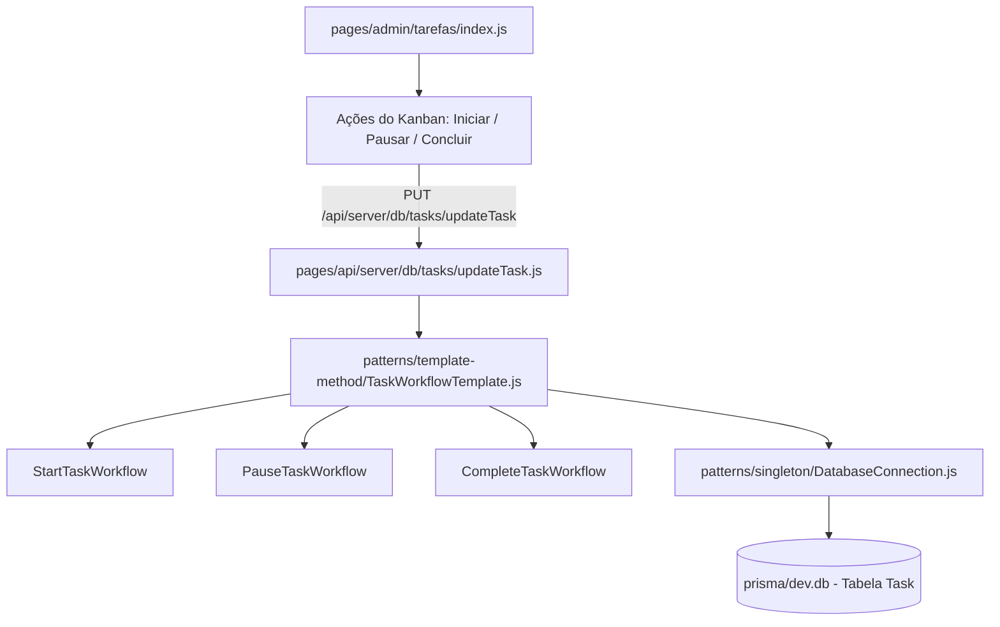

# 📘 Roteiro de Apresentação — Integrante 4
**Módulo:** Gestão de Tarefas (Kanban), Operações Financeiras e Padrões GoF (Template Method & Singleton)  
**Projeto:** Reuso_med (Engenharia de Reúso de Software)  
**Data da Avaliação:** 16/10/2026

---

## 1. Visão Geral das Responsabilidades

Você é o responsável pelo módulo de **Gestão Operacional de Tarefas (Kanban com Time Tracker) e Lançamentos Financeiros**, e pela demonstração do padrão GoF **Template Method** (no ciclo de vida de tarefas) e do padrão GoF **Singleton** (conexão e configuração central).

| Recurso | Detalhes |
| :--- | :--- |
| **Tela 1 (CRUD)** | **Quadro de Tarefas & Time Tracker** (`http://localhost:3000/admin/tarefas`) |
| **Tela 2 (CRUD)** | **Gestão Financeira & Vendas** (`http://localhost:3000/admin/finance`) |
| **Tabelas do Banco (Prisma)** | `Task`, `Sale`, `Payment` |
| **Padrões GoF Principais** | **Template Method** (`TaskWorkflowTemplate.js`) + **Singleton** (`DatabaseConnection.js` e `AppConfigService.js`) |

---

## 2. Detalhamento da Tela 1: Quadro de Tarefas (`/admin/tarefas`)

### A. O que a tela faz:
1. **Quadro Kanban Interativo**: Visualização de tarefas divididas por colunas de status (`A_FAZER`, `EM_ANDAMENTO`, `CONCLUIDA`).
2. **Criação de Tarefa (Create)**: Formulário para cadastrar novas demandas, atribuir prioridade (`ALTA`, `MEDIA`, `BAIXA`), vincular a uma empresa cliente e designar um operador responsável.
3. **Time Tracker & Transições de Status (Update)**:
   - **Iniciar Tarefa**: Marca a data de início e dispara o cronômetro de apontamento de horas.
   - **Pausar Tarefa**: Congela o timer, calcula os minutos trabalhados na sessão e acumula no campo `totalTimeWorked` da tabela `Task`.
   - **Concluir Tarefa**: Finaliza o ciclo de vida, trava edições e gera log de conclusão.
4. **Exclusão de Tarefa (Delete)**: Remoção segura de itens cancelados do banco de dados.

### B. Fluxo Completo de Arquivos (Da Interface ao Banco):

1. **Frontend**: `pages/admin/tarefas/index.js` gerencia as colunas do Kanban, modais de criação e o cronômetro do time tracker.
2. **Backend**:
   - `pages/api/server/db/tasks/getTasks.js`: Busca as tarefas cadastradas com os dados do responsável (`User`) e cliente (`Company`).
   - `pages/api/server/db/tasks/createTask.js`: Insere nova tarefa com status inicial `A_FAZER`.
   - `pages/api/server/db/tasks/updateTask.js`: **Refatorado com o padrão Template Method**. Em vez de 80 linhas de `if/else` procedurais, instancia `StartTaskWorkflow`, `PauseTaskWorkflow` ou `CompleteTaskWorkflow`.
   - `pages/api/server/db/tasks/deleteTask.js`: Exclui registros da tabela `Task`.
3. **Padrão Template Method**:
   - `patterns/template-method/TaskWorkflowTemplate.js`:
     - Método invariante `execute(taskId, taskData)`: `loadTask()` ➔ `validateTransition()` ➔ `applyBusinessRules()` ➔ `save()` ➔ `postProcess()`.
     - Subclasses concretas sobrescrevem os hooks específicos:
       - `StartTaskWorkflow`: Valida se já não há outra tarefa em andamento e grava `startedAt`.
       - `PauseTaskWorkflow`: Calcula a diferença de tempo em milissegundos e soma ao `totalTimeWorked`.
       - `CompleteTaskWorkflow`: Valida requisitos mínimos e fecha a data `finishedAt`.
4. **Persistência**: Tabela `Task` no SQLite.

---

## 3. Detalhamento da Tela 2: Gestão Financeira & Vendas (`/admin/finance`)

### A. O que a tela faz:
1. **Cards de KPIs Consolidados**: Total de faturamento, pagamentos aprovados e pendências atualizados por período (hoje, 7 dias, 30 dias, anual).
2. **Lançamento Manual de Pedidos (Create)**: Modal para registrar vendas avulsas e entradas manuais associadas a empresas cadastradas.
3. **Tabela de Pedidos Recentes**: Listagem de transações com método de pagamento, status de liquidação e valor formatado em Real (R$).
4. **Conexão Relacional Segura**: Utiliza validação de teto numérico (blindagem contra estouro de 32 bits) e conexão relacional no Prisma.

### B. Fluxo Completo de Arquivos:
1. **Frontend**: `pages/admin/finance/index.js` renderiza os gráficos de tendências, cards de KPIs e o modal de criação de pedidos manuais.
2. **APIs e Serviços**:
   - `pages/api/orders/create-manual.js`: Valida o payload de entrada (empresa, valor e método) e aciona `paymentService.js`.
   - `services/paymentService.js`: Contexto de execução que seleciona a estratégia de pagamento e chama o repositório.
   - `repositories/paymentRepository.js`: Realiza a persistência relacional do pagamento no Prisma (`connect: { id: companyId }`).
   - `pages/api/server/db/finance/getRecentPayments.js` e `getTotalApprovedPayments.js`: Alimentam os cards de métricas e tabelas.
3. **Persistência**: Tabelas `Payment`, `Sale` e `Company` no SQLite.

---

## 4. O que Defender sobre os Padrões GoF (Singleton & Template Method)

### 1. Padrão GoF Singleton
- **Arquivos:** [`patterns/singleton/DatabaseConnection.js`](file:///home/matheus/Documentos/Faculdade/Reuso_med/patterns/singleton/DatabaseConnection.js) e [`AppConfigService.js`](file:///home/matheus/Documentos/Faculdade/Reuso_med/patterns/singleton/AppConfigService.js).
- **Problema de Reúso:** Em aplicações Node.js e Next.js com *Hot Reloading*, cada requisição poderia instanciar um novo `PrismaClient`, esgotando rapidamente o pool de conexões do banco de dados e duplicando instâncias de configurações globais.
- **Solução:** Implementamos o Singleton clássico salvando a instância em `globalThis` e congelando o objeto com `Object.freeze()`. Toda a aplicação reutiliza a mesma e única conexão com o SQLite.

### 2. Padrão GoF Template Method (Workflow de Tarefas)
- **Arquivo:** [`patterns/template-method/TaskWorkflowTemplate.js`](file:///home/matheus/Documentos/Faculdade/Reuso_med/patterns/template-method/TaskWorkflowTemplate.js).
- **Problema de Reúso:** Qualquer mudança de estado de uma tarefa (Iniciar, Pausar, Finalizar) exige carregar a tarefa, validar se a transição é permitida, atualizar o banco e disparar logs.
- **Solução:** O método esqueleto padroniza a ordem das operações, e cada subclasse implementa apenas a sua regra de cálculo de tempo ou validação específica.

---

## 5. Script de Apresentação (O que falar na banca)

> *"Bom dia/Boa tarde, professor. Eu sou o Integrante 4 e fui responsável pelo módulo Operacional de Tarefas e Gestão Financeira de Vendas, além da aplicação dos padrões GoF **Singleton** e **Template Method**.*
>
> *(Abrir a tela `/admin/tarefas` no navegador)*  
> *Na tela de Tarefas temos o quadro Kanban conectado à tabela `Task` do SQLite. O usuário pode criar novas tarefas da equipe, atribuir prioridade e responsável.*
>
> *O diferencial de arquitetura aqui é o uso do **Template Method** no ciclo de vida da tarefa (`TaskWorkflowTemplate.js`). Quando o operador clica para Iniciar ou Pausar uma tarefa, a requisição aciona um fluxo invariante que carrega a tarefa, valida se a transição de estado é válida e calcula com precisão os minutos trabalhados na sessão através de métodos gancho (*hooks*), acumulando as horas no banco de forma desacoplada.*
>
> *(Abrir a tela `/admin/finance` no navegador)*  
> *Na tela de Financeiro temos a visão executiva de vendas e pagamentos recentes. O modal de pedidos manuais aciona o serviço de pagamento que criamos, gravando a transação nas tabelas `Payment` e `Company`.*
>
> *Por fim, tanto estas telas quanto todas as outras do sistema operam sobre o padrão **Singleton** implementado em `DatabaseConnection.js`. Isso garante que 100% das APIs reutilizem uma única conexão controlada com o banco SQLite, evitando vazamento de memória e concorrência no pool."*
